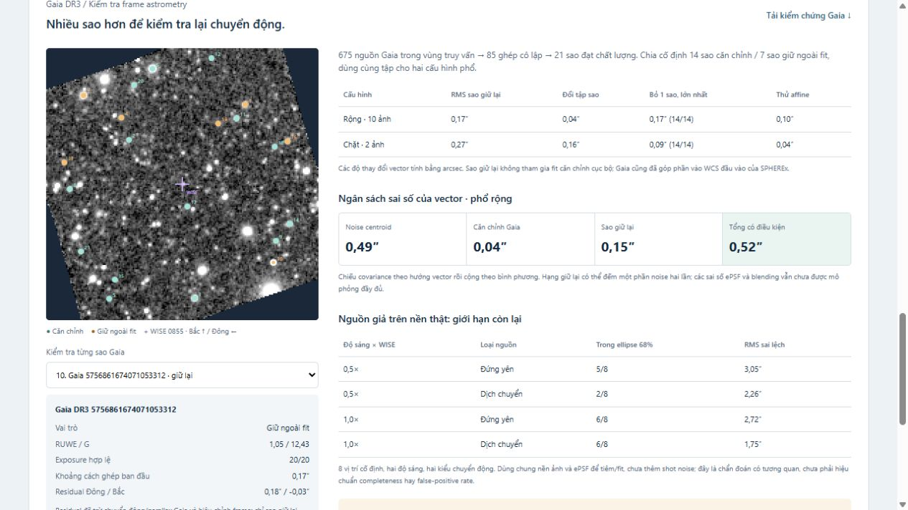

# nosleepclub_nasa_spherex

NoSleepClub · NASA Space Apps Challenge 2026 · [Planet X and SPHEREx](https://www.spaceappschallenge.org/2026/challenges/planet-x-and-spherex/?tab=details).

Web giúp so sánh ảnh SPHEREx theo thời gian, đánh dấu vùng sai khác và đưa cho con người kiểm tra.

Production: **https://nosleepclub-nasa-spherex.vercel.app** · [Deployment](docs/DEPLOYMENT.md) · [Nghiên cứu và A/B độ chính xác 0.4.0](docs/ACCURACY_RESEARCH.md).

## Demo hiện tại: WISE 0855



- Giữ cùng 20 exposure của bản cộng ảnh, mở cutout từ 0,12° lên 0,32° và đối chiếu 675 nguồn Gaia DR3.
- Chọn 21 sao đạt chất lượng: 14 sao căn chỉnh, 7 sao giữ ngoài fit. Lan truyền vị trí/proper motion/parallax và covariance Gaia đến ngày quan sát.
- Cấu hình phổ rộng: **3,29″ ± 0,52″** trong 163,5 ngày; đổi tập sao làm vector đổi **0,04″**, bỏ từng sao lớn nhất **0,17″**, thử affine **0,10″**. Đây là sai số theo mô hình có điều kiện.
- Bản đồ Gaia tương tác, bảng ngân sách sai số, kiểm tra nguồn giả tại 8 vị trí/hai độ sáng; giữ cả hai cấu hình trước Gaia và ba cặp ảnh đơn cũ.
- So sánh kéo vạch, song song, sai khác và nhấp nháy; zoom, highlight và bảng bằng chứng.
- Nhận xét production lưu MongoDB theo phiên trình duyệt; có local fallback, xuất JSON và xóa theo vùng.
- Giao diện bỏ subtext; phương pháp/giới hạn nằm trong bảng bằng chứng. Thêm bảng A/B fit nhiều nguồn với 12 vùng mới, hai mức sáng và hai loại chuyển động.
- FITS đã xử lý, arrays và manifest có nguồn, hash và phiên bản để kiểm tra lại.

**Dấu hiệu chuyển động, chưa xác nhận.** Phổ chặt là cấu hình chính: **3,06″ ± 0,99″**; phổ rộng là kiểm tra độ nhạy và dùng chung một phần ảnh. Nguồn giả đứng yên cùng độ sáng trên tám nền ảnh khác vẫn có RMS lệch **2,72″** ở cấu hình rộng; nguồn dịch chuyển bằng nửa độ sáng chỉ có **2/8** lượt nằm trong ellipse sai số 68%. Vector rộng còn chênh **1,21″** so với dự báo ngoài. Gaia làm rõ độ ổn định của frame, chưa giải quyết toàn bộ blending, ePSF và đáp ứng phổ. Chưa có vision model được huấn luyện.

## Mở demo ngay

Ứng dụng dùng các sản phẩm nhỏ đã có sẵn trong repo; chỉ cần Python để mở, không cần Node hoặc tải lại dữ liệu.

```sh
git clone https://github.com/dakiemdarktharr/nosleepclub_nasa_spherex.git
cd nosleepclub_nasa_spherex
python scripts/serve_demo.py
```

Mở **http://127.0.0.1:8766**. Có thể đổi cổng bằng `--port 8767`. Server chỉ phục vụ thư mục `web/`, bind vào localhost. Các tệp trong `web/` cũng có thể được phục vụ bằng static hosting có hỗ trợ JSON/PNG/FITS.

## Tái tạo kết quả khoa học

Python 3.11 trở lên; nên dùng virtual environment. Các phiên bản trong `requirements.txt` là phiên bản đã chạy trên máy phát triển.

```sh
python -m venv .venv
.venv\Scripts\python -m pip install -r requirements.txt
.venv\Scripts\python scripts/fetch_wise0855.py
.venv\Scripts\python scripts/fetch_wise0855.py --demo
.venv\Scripts\python scripts/build_demo.py
.venv\Scripts\python scripts/prepare_motion_data.py
.venv\Scripts\python scripts/motion_analysis.py
.venv\Scripts\python scripts/prepare_gaia_data.py
.venv\Scripts\python scripts/gaia_motion.py --publish
.venv\Scripts\python -m unittest discover -s tests -v
```

Lệnh `--demo` tải 6 cutout được chọn và kiểm tra FITS; lưu trong `data/raw/wise0855/target-centered/`. Chạy fetch không có `--demo` để quét các quan sát D6 trong vùng truy vấn ban đầu, hiện đã kiểm tra 43 quan sát. Download có cache và giới hạn 3 request đồng thời.

`prepare_motion_data.py` chọn 31 cutout trong hai cửa sổ epoch, tải lại quanh mục tiêu và lấy hai tệp hiệu chuẩn chính thức đã ghim phiên bản/hash. Phân tích dùng 2 hoặc 10 cặp phù hợp phổ; không dùng tất cả 31 ảnh để cộng. `motion_analysis.py` chạy 128 mô phỏng noise mỗi epoch/cấu hình, xuất covariance, đối chứng và hai bộ sản phẩm web. Chạy `build_demo.py` trước rồi `motion_analysis.py` để manifest chứa cả ảnh đơn và ảnh cộng. Test chạy offline; chỉ kiểm tra hash raw khi có cache.

`prepare_gaia_data.py` tải cutout rộng của đúng 20 exposure cũ và truy vấn Gaia DR3 qua IRSA TAP, lưu ADQL/URL/hash. `gaia_motion.py --publish` cache centroid sao tham chiếu, chạy đổi tập sao, 14 lượt bỏ từng sao, affine, 256 bootstrap căn chỉnh và 32 injection mỗi cấu hình; sau đó thêm sản phẩm Gaia vào demo. Chạy các bước theo thứ tự trên nếu tái tạo toàn bộ manifest. 31 kiểm thử kiểm tra cả các sản phẩm đã commit mà không cần tải raw.

Thí nghiệm 0.4.0: `python -m scripts.joint_motion --configuration broad`, lặp lại với `strict`, rồi `python -m scripts.summarize_joint`. 192 phép phục hồi nguồn giả và 128 bootstrap/epoch/mô hình. Fit nhiều nguồn chưa cải thiện đồng đều; **chưa thay bản 0.3.0 làm mặc định**. Xem RMS, số fit lỗi và so sánh ghép cặp trong tài liệu accuracy. Toàn bộ suite hiện có 38 kiểm thử offline, gồm API validation và deblending tổng hợp.

## Tài liệu

- [Gaia, độ ổn định vector, sai số và milestone tiếp theo](docs/WISE0855_GAIA.md)
- [Research cải thiện công cụ và danh mục nhập Zotero](docs/GAIA_RESEARCH.md)
- [Bản cộng ảnh trước Gaia](docs/WISE0855_COADD.md)
- [Baseline ba cặp ảnh đơn ban đầu](docs/WISE0855_DEMO.md)
- [Phân tích vision model và quy trình review](docs/DEEP_RESEARCH_VISION.md)
- [Tóm tắt đề bài](docs/CHALLENGE.md)
- [Lộ trình](docs/ROADMAP.md)
- [Hướng dẫn đóng góp](CONTRIBUTING.md)

## Dữ liệu và giấy phép

Dữ liệu gốc: SPHEREx QR2 tại NASA/IPAC IRSA, DOI [10.26131/IRSA652](https://doi.org/10.26131/IRSA652). Các PNG/FITS trong `web/data/` là sản phẩm xử lý phục vụ demo, không phải sản phẩm khoa học chính thức của IRSA. Manifest giữ URL cutout, SHA-256, observation ID và pipeline version.

Không commit token hoặc bộ FITS thô lớn. Repo hiện chưa cấp giấy phép mã nguồn; cần thống nhất giấy phép của nhóm. Dữ liệu và tài sản bên thứ ba giữ điều kiện sử dụng riêng.
