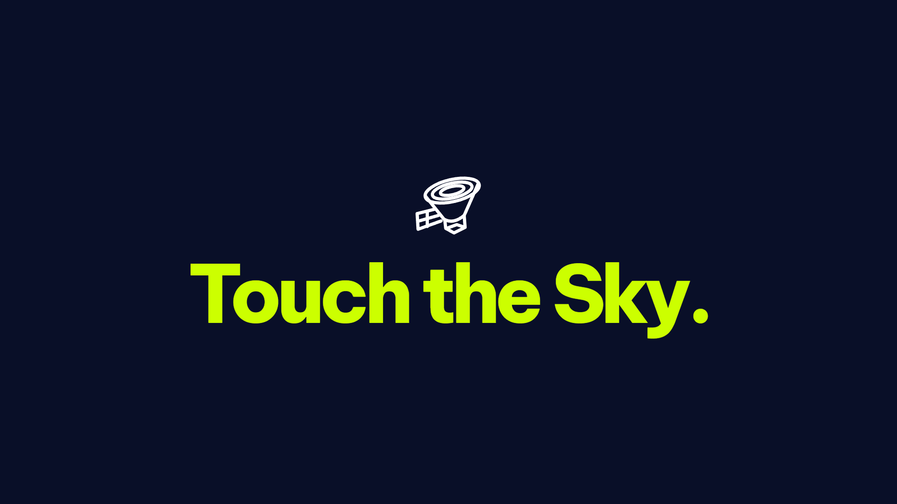
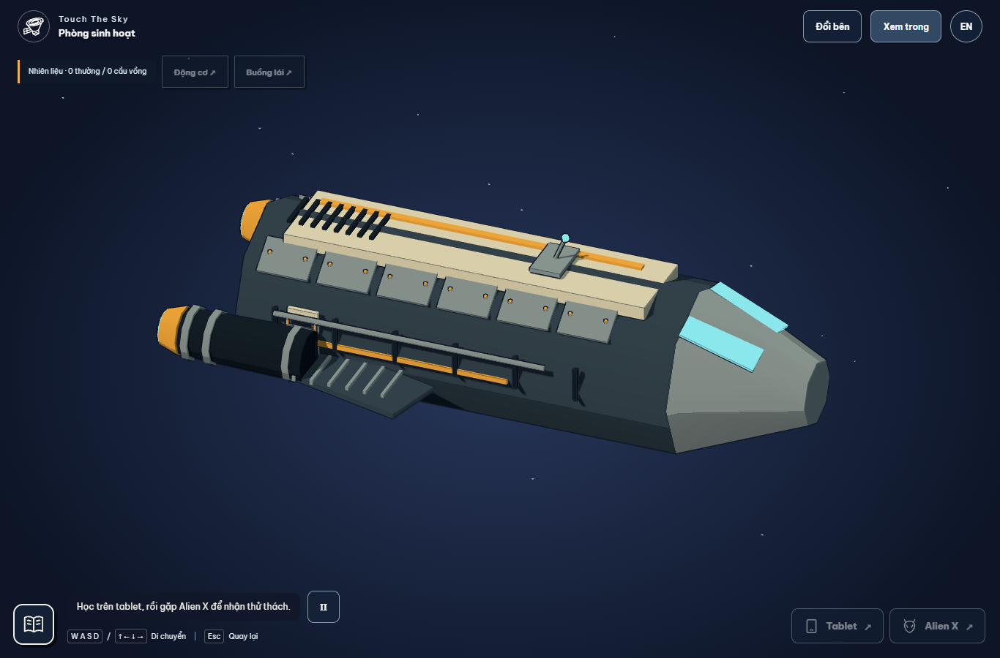
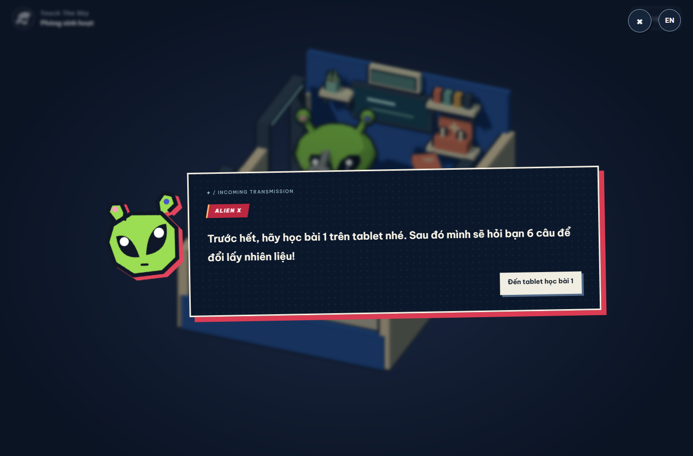
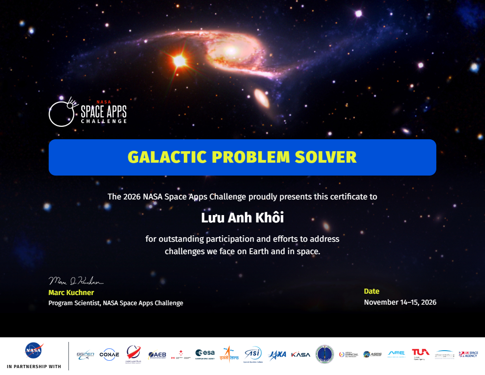

# Touch The Sky

**NoSleepClub · NASA Space Apps Challenge 2026 · [Planet X and SPHEREx](https://www.spaceappschallenge.org/2026/challenges/planet-x-and-spherex/?tab=details)**

Touch The Sky is an educational website for middle-school learners and anyone curious about space. It helps visitors understand NASA’s SPHEREx mission through a playable learning story, short lessons, a mission guide, and an interactive way to explore real SPHEREx images. The goal is to make infrared astronomy approachable, build confidence in reading scientific images, and encourage learners to ask what the data can—and cannot—show.

**[Play the learning mission](https://nosleepclub-nasa-spherex.vercel.app/?lang=en#learn)** · [Explore the sky](https://nosleepclub-nasa-spherex.vercel.app/?lang=en#night-sky) · [Tiếng Việt](https://nosleepclub-nasa-spherex.vercel.app/?lang=vi) · [Documentation](docs/README.md)

## Watch the 30-second pitch

[](https://github.com/dakiemdarktharr/nosleepclub_nasa_spherex/releases/download/pitch-v3/Touch-the-Sky-30s-v3.mp4)

**[Watch / download MP4](https://github.com/dakiemdarktharr/nosleepclub_nasa_spherex/releases/download/pitch-v3/Touch-the-Sky-30s-v3.mp4)** · [English subtitles](docs/assets/readme/pitch-en.srt) · [Vietnamese subtitles](docs/assets/readme/pitch-vi.srt) · [Media credits](docs/assets/readme/README.md)

30 seconds · 1080p · English narration and captions. The film shows real game and image-comparison interactions, accelerated for the pitch. It records an earlier interface revision; the screenshots below show the newer ship and dialogue.

## Step aboard



Explore the ship with Gagoo, open a lesson on the tablet, and meet Alien X for a six-question challenge. Earn fuel, load the thruster, and launch: regular fuel takes the story to 1/3 of the route; rainbow fuel travels through a wormhole to 2/3.

<details>
<summary>Meet Alien X</summary>



</details>

## Learn, then explore

### Explore three short lessons

The lesson journal is designed for learners around grades 6–9 and for self-guided exploration. Its three activities take about 19 minutes in total:

1. **Why does SPHEREx photograph the same patch of sky again?** Learn how filters separate infrared wavelengths and why the same region can look different across bands.
2. **Can you find the same group of dots again?** Navigate a saved sequence of three real SPHEREx observations of the Epsilon Indi B field, recorded on 29 April, 1 May, and 7 May 2025 UTC.
3. **Did the bright dot really disappear?** Read missing-data and quality masks, compare image alignment, and consider what evidence is needed before claiming a source changed.

Each lesson includes an activity and connects to a six-question quiz with explanations. The material has not yet been evaluated in a formal classroom study.

### Get to know SPHEREx

The [mission guide](https://nosleepclub-nasa-spherex.vercel.app/?lang=en#about) introduces the observatory, infrared light, detectors and filters, with links to NASA and the archive. Illustrations explain the instrument; they are labeled separately from observations.

### Explore real SPHEREx images

From **Explore the Sky**, visitors can select an example target or search by right ascension and declination. Search options include the **DR1** or **QR3** release, detector band, field of view, and an optional date range. The app queries the NASA/IPAC Infrared Science Archive (IRSA), lists available observations, and retrieves FITS cutouts for viewing.

The image viewer can:

- Compare two observations side by side on a shared view, or blink between them.
- Inspect compatible observations as a time sequence, with observation dates and metadata for each frame.
- Show the selected detector band and the wavelength at the target position when the FITS metadata supports it.
- Identify masked or missing pixels and provide links to source FITS files and provenance records.
- Export the query and viewed-frame metadata for later reference.

For comparisons, the app reads the FITS WCS/SIP coordinate solution and resamples images to a common tangent-plane grid. It applies consistent display and mask rules to the compared frames. Time playback is limited to compatible observations; it is a viewing aid, not a motion or variability measurement. The sequence eligibility rule checks detector, mask policy, usable center pixels, and wavelength overlap at the field center. Scientific claims require separate analysis of calibration, alignment, masks, uncertainty, and the underlying measurements.

## Run locally

Use Python 3.12 and a virtual environment. The web preview needs only the web requirements; Node.js and the offline science packages are not needed to run it.

```sh
git clone https://github.com/dakiemdarktharr/nosleepclub_nasa_spherex.git
cd nosleepclub_nasa_spherex
python -m venv .venv
```

Activate the environment with `.venv\Scripts\Activate.ps1` on Windows PowerShell, or `source .venv/bin/activate` on macOS/Linux. Then:

```sh
python -m pip install -r web/requirements.txt
python scripts/serve_app.py
```

Open [localhost:8767](http://127.0.0.1:8767/). New IRSA searches need internet access. The saved Epsilon Indi B sequence remains available when the archive is slow or unreachable.

For the bundled static demo, run `python scripts/serve_demo.py` and open [localhost:8766](http://127.0.0.1:8766/). This mode does not provide live archive API routes.

## Technology

- **Frontend:** HTML, CSS, and modular JavaScript. Interactive spacecraft and sky scenes use WebGL, with Three.js bundled in `web/assets/three-0.187.0/`.
- **Mission and learning content:** Structured lesson data, bilingual interface copy, interactive diagrams, quizzes, and browser-local progress storage.
- **Archive access and image handling:** NASA/IPAC IRSA SIA queries and FITS cutouts; Python services use Astropy, NumPy, and Pillow for FITS/WCS handling and image preparation.
- **Local preview:** A Python launcher serves the web app and its local API routes. The static demo server can also serve the saved educational products without the live API.
- **Deployment:** Vercel serves the site and Python API routes. Selected review features use an isolated MongoDB database.

The original research and validation work remains documented under [`docs/`](docs/). Those reports include methods, data provenance, uncertainty qualifications, and open limitations. They should be read in context; their presence does not mean every exploratory analysis is a validated astronomical result.

## Repository guide

| Location | What you will find |
| --- | --- |
| [`web/`](web/) | Static interface, learning game, bundled assets and Python API routes |
| [`scripts/`](scripts/) | Local servers, offline science processing and browser checks |
| [`tests/`](tests/) | Python and JavaScript verification |
| [`docs/`](docs/README.md) | Product guides, deployment, research methods and evidence |
| [`web/data/`](web/data/) | Versioned demo products with scientific provenance |
| `data/raw/` | Ignored local downloads, captures and working files |

Start with the [documentation index](docs/README.md), [contribution guide](CONTRIBUTING.md), or [deployment guide](docs/DEPLOYMENT.md). Historical validation results and reproduction commands are retained in the [research snapshot](docs/archive/readme-before-media-2026-11-16.md).

## NASA Space Apps 2026

**Galactic Problem Solver** participation certificate awarded to **Lưu Anh Khôi**, dated **November 14–15, 2026**.

[](docs/assets/readme/space-apps-2026-certificate.jpeg)

## What the evidence means

- The ship, aliens, fuel and wormholes are fictional learning mechanics. Progress is stored in the current browser, not an account.
- The explorer displays processed SPHEREx observations. Assigned colors, masks and wavelength choices affect their appearance; a visible difference alone does not establish motion or variability.
- The saved Epsilon Indi B sequence supports image-reading practice. It does not resolve the pair or confirm a change.
- Research on WISE 0855 remains exploratory. This project has not confirmed Planet X or a new astronomical detection. Classroom learning outcomes have not yet been measured in a formal study.

See the [dataset catalog](docs/DATASET_CATALOG.md), [scientific readiness checklist](docs/PRODUCTION_READINESS.md), and [IRSA archive documentation](https://caltech-ipac.github.io/spherex-archive-documentation/) for sources and qualifications.

## License and credits

Original project code and original documentation use the [MIT License](LICENSE). NASA/IRSA data, fonts, illustrations, generated pitch audio and the certificate retain their own terms; see [NOTICE](NOTICE.md) and [media provenance](docs/assets/readme/README.md).

This is an independent NASA Space Apps Challenge project, not an official NASA product or endorsement.
