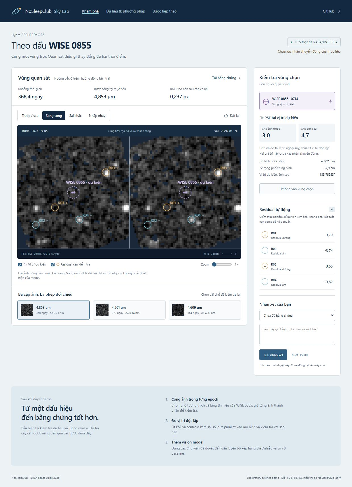

# nosleepclub_nasa_spherex

NoSleepClub · NASA Space Apps Challenge 2026 · [Planet X and SPHEREx](https://www.spaceappschallenge.org/2026/challenges/planet-x-and-spherex/?tab=details).

Web giúp so sánh ảnh SPHEREx theo thời gian, đánh dấu vùng sai khác và đưa cho con người kiểm tra.

## Demo hiện tại: WISE 0855



- Ba cặp cutout **thật** từ SPHEREx QR2/IRSA, đã kiểm tra bước sóng và đưa về cùng lưới trời.
- So sánh kéo vạch, song song, sai khác và nhấp nháy; zoom, highlight và bảng bằng chứng.
- Lưu/xuất nhận xét trong trình duyệt; có thể xóa nhận xét theo vùng.
- FITS đã xử lý, arrays và manifest có nguồn, hash và phiên bản để kiểm tra lại.

**Chưa xác nhận chuyển động WISE 0855.** Đây là baseline xử lý ảnh cổ điển; chưa có vision model được huấn luyện. Vòng nét đứt là vị trí ngoại suy từ astrometry cũ, khác với residual tự động. S/N ở vị trí cố định chưa phải bằng chứng đo chuyển động.

## Mở demo ngay

Ứng dụng dùng các sản phẩm nhỏ đã có sẵn trong repo; chỉ cần Python để mở, không cần Node hoặc tải lại dữ liệu.

```sh
git clone https://github.com/dakiemdarktharr/nosleepclub_nasa_spherex.git
cd nosleepclub_nasa_spherex
python scripts/serve_demo.py
```

Mở **http://127.0.0.1:8766**. Có thể đổi cổng bằng `--port 8767`. Server chỉ phục vụ thư mục `web/`, bind vào localhost. Các tệp trong `web/` cũng có thể được phục vụ bằng static hosting có hỗ trợ JSON/PNG/FITS.

## Tái tạo kết quả khoa học

Python 3.11 trở lên; nên dùng virtual environment. Các phiên bản trong `requirements.txt` là phiên bản đã chạy trên máy phát triển.

```sh
python -m venv .venv
.venv\Scripts\python -m pip install -r requirements.txt
.venv\Scripts\python scripts/fetch_wise0855.py --demo
.venv\Scripts\python scripts/build_demo.py
.venv\Scripts\python -m unittest discover -s tests -v
```

Lệnh `--demo` tải 6 cutout được chọn và kiểm tra FITS; lưu trong `data/raw/wise0855/target-centered/`. Chạy fetch không có `--demo` để quét các quan sát D6 trong vùng truy vấn ban đầu, hiện đã kiểm tra 43 quan sát. Download có cache và giới hạn 3 request đồng thời.

## Tài liệu

- [Kết quả, phương pháp và bước tiếp theo của demo](docs/WISE0855_DEMO.md)
- [Phân tích vision model và quy trình review](docs/DEEP_RESEARCH_VISION.md)
- [Tóm tắt đề bài](docs/CHALLENGE.md)
- [Lộ trình](docs/ROADMAP.md)
- [Hướng dẫn đóng góp](CONTRIBUTING.md)

## Dữ liệu và giấy phép

Dữ liệu gốc: SPHEREx QR2 tại NASA/IPAC IRSA, DOI [10.26131/IRSA652](https://doi.org/10.26131/IRSA652). Các PNG/FITS trong `web/data/` là sản phẩm xử lý phục vụ demo, không phải sản phẩm khoa học chính thức của IRSA. Manifest giữ URL cutout, SHA-256, observation ID và pipeline version.

Không commit token hoặc bộ FITS thô lớn. Repo hiện chưa cấp giấy phép mã nguồn; cần thống nhất giấy phép của nhóm. Dữ liệu và tài sản bên thứ ba giữ điều kiện sử dụng riêng.
