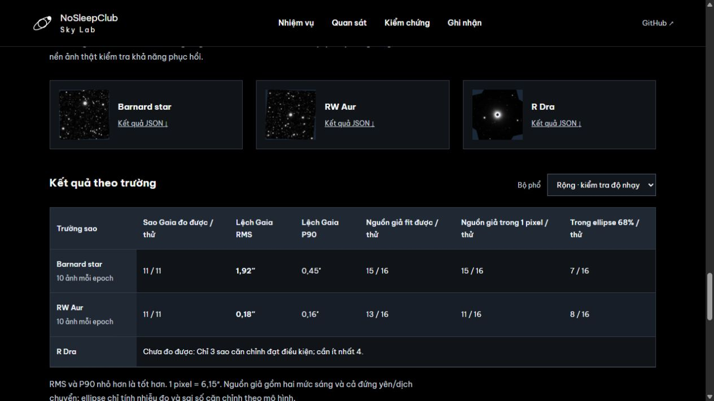
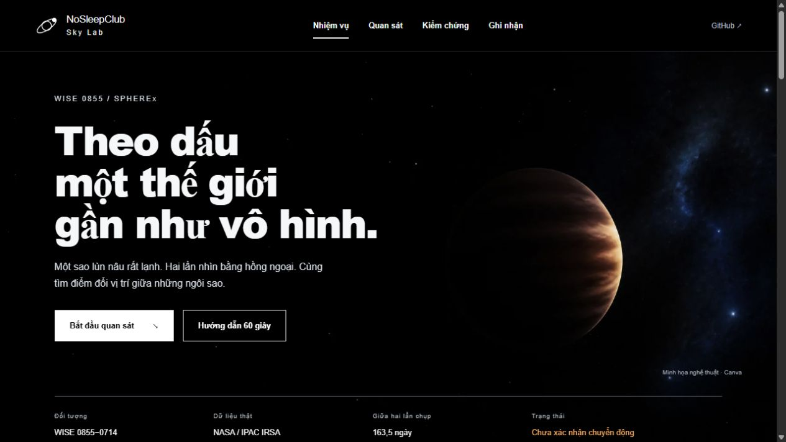
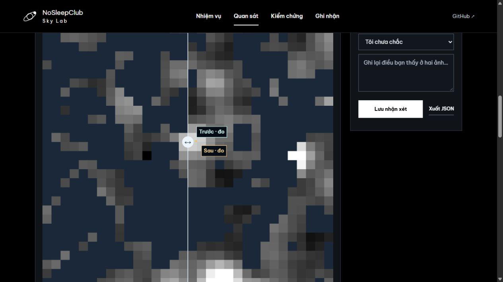

# nosleepclub_nasa_spherex

NoSleepClub · NASA Space Apps Challenge 2026 · [Planet X and SPHEREx](https://www.spaceappschallenge.org/2026/challenges/planet-x-and-spherex/?tab=details).

Web giúp so sánh ảnh SPHEREx theo thời gian, đánh dấu vùng sai khác và đưa cho con người kiểm tra.

**[Mở Sky Lab](https://nosleepclub-nasa-spherex.vercel.app)** · [Benchmark dataset mới](https://nosleepclub-nasa-spherex.vercel.app/#external-benchmark) · [Cách triển khai](docs/DEPLOYMENT.md) · [Báo cáo kiểm chứng mới nhất](docs/EXTERNAL_BENCHMARK.md).

## Bắt đầu trên web

1. Chọn **Bắt đầu quan sát**. Kéo vạch trước/sau hoặc bật **Nhấp nháy** để tìm điểm đổi vị trí.
2. Mở **Kiểm chứng** để xem sai lệch phục hồi, số fit lỗi và giới hạn của kết quả.
3. Chọn **Ghi nhận**, lưu điều bạn thấy; có thể chọn **Tôi chưa chắc**, xuất JSON hoặc xóa nhận xét.

Nút **Hướng dẫn 60 giây** giải thích sao lùn nâu, pixel, ellipse sai số và cách đọc ảnh. Người có kinh nghiệm có thể mở bảng tọa độ, dữ liệu Gaia, FITS và cấu hình đầy đủ.

## Kiểm tra trên dataset mới — 0.6.0

Đã tải **129 cutout QR2** ở ba trường Barnard’s Star, RW Aur và R Draconis, đối chiếu **6.736 hàng Gaia DR3**. Khóa code/dataset/chia mẫu tại commit `8aa2536` trước khi đo. Không thay số đo WISE 0855.

| Trường, phổ rộng | Sao giữ ngoài đo được / thử | RMS lệch vector so Gaia | Nguồn giả fit được / thử | RMS nguồn giả hợp lệ |
|---|---:|---:|---:|---:|
| Barnard | 11/11 | 1,921″ | 15/16 | 2,103″ |
| RW Aur | 11/11 | 0,182″ | 13/16 | 6,009″ |
| R Dra | Chưa đo được | Chỉ 3 sao căn chỉnh, cần ≥4 | — | — |



Barnard có một outlier Gaia **6,309″**. Chính mục tiêu Barnard lệch dự báo **2,628″**, χ²r rất cao dù solver hội tụ. Nguồn mờ trên nền RW Aur phục hồi kém hơn nhiều so với sao Gaia sáng. Phổ chặt/rộng Barnard dùng đúng cùng cặp ảnh; không tính là hai kiểm chứng độc lập.

**Chưa có tỷ lệ chính xác chung hoặc precision/recall tìm kiếm mù.** Đây là kiểm tra local fitting ở vị trí đã biết; 32 tình huống nguồn giả duy nhất, dùng cùng họ ePSF với fitter và ngân sách ellipse còn thiếu hệ thống. [Dataset, phương pháp, kết quả theo độ sáng và cách tái tạo](docs/EXTERNAL_BENCHMARK.md).

## Giao diện dễ đọc

- Dùng **Be Vietnam Pro** ở năm độ đậm 400–800, gồm bộ ký tự Vietnamese và Latin. Font WOFF2 được phục vụ ngay từ repo, dùng được khi mở demo offline; không gọi dịch vụ font bên ngoài lúc chạy.
- Tăng khoảng cách dòng để dấu tiếng Việt không bị cắt. Bảng, chỉ dẫn và nhãn điều khiển dùng cỡ chữ lớn hơn trên desktop/mobile.
- Chữ trên ảnh có nền tối đặc và viền riêng; chữ biểu đồ sáng hơn. Các cặp màu chính đã kiểm tra có tương phản trên 10:1.
- Tách phần mô tả, nút và dải thông tin đầu trang theo luồng bố cục, tránh chồng nội dung khi chữ xuống dòng. Nhận xét không bị giữ ngoài màn hình ở viewport thấp.

[Chi tiết kiểm tra độ dễ đọc](docs/READABILITY.md) · [Nguồn font](https://github.com/google/fonts/tree/main/ofl/bevietnampro) · [Giấy phép SIL OFL](web/assets/fonts/OFL.txt).

**Kiểm chứng 0.5.0:** [QR3/CatWISE/ePSF và 30 vùng khóa trước](docs/QR3_CATWISE_VALIDATION.md). QR3 chưa phủ tọa độ truy vấn ở cả SIA và TAP. Đã bổ sung catalog IR có hiệu chỉnh tile, so ba mô hình bằng 1.440 phép phục hồi; phổ rộng có điểm ước lượng tốt hơn, chưa mô hình nào qua gate ở cả hai cấu hình. Giữ phép đo cũ làm mặc định. Minh họa Canva luôn tách rõ khỏi FITS thật.

| Thành phần | Phiên bản | Vai trò |
|---|---|---|
| Giao diện và benchmark mới | 0.6.0 | Font tiếng Việt, so ảnh, kiểm chứng ba trường và nhận xét |
| Thí nghiệm catalog IR/ePSF | 0.5.0 | 30 vùng khóa trước; chưa thay số đo mặc định |
| Phép đo mặc định | 0.3.0 | Pixel gốc, căn chỉnh Gaia; chuyển động chưa xác nhận |

## Demo hiện tại: WISE 0855



- Giữ cùng 20 exposure của bản cộng ảnh, mở cutout từ 0,12° lên 0,32° và đối chiếu 675 nguồn Gaia DR3.
- Chọn 21 sao đạt chất lượng: 14 sao căn chỉnh, 7 sao giữ ngoài fit. Lan truyền vị trí/proper motion/parallax và covariance Gaia đến ngày quan sát.
- Cấu hình phổ rộng: **3,29″ ± 0,52″** trong 163,5 ngày; đổi tập sao làm vector đổi **0,04″**, bỏ từng sao lớn nhất **0,17″**, thử affine **0,10″**. Đây là sai số theo mô hình có điều kiện.
- Bản đồ Gaia tương tác, bảng ngân sách sai số, kiểm tra nguồn giả tại 8 vị trí/hai độ sáng; giữ cả hai cấu hình trước Gaia và ba cặp ảnh đơn cũ.
- So sánh kéo vạch, song song, sai khác và nhấp nháy; zoom, highlight và bảng bằng chứng.
- Nhận xét production lưu MongoDB theo phiên trình duyệt; có local fallback, xuất JSON và xóa theo vùng.
- Hướng dẫn thao tác ngắn trong giao diện; phương pháp/giới hạn đầy đủ mở theo nhu cầu. Bảng A/B có bộ lọc phổ và ePSF, cùng bản đồ 30 vùng kiểm thử.
- FITS đã xử lý, arrays và manifest có nguồn, hash và phiên bản để kiểm tra lại.



**Dấu hiệu chuyển động, chưa xác nhận.** Phổ chặt là cấu hình chính: **3,06″ ± 0,99″**; phổ rộng là kiểm tra độ nhạy và dùng chung một phần ảnh. Nguồn giả đứng yên cùng độ sáng trên tám nền ảnh khác vẫn có RMS lệch **2,72″** ở cấu hình rộng; nguồn dịch chuyển bằng nửa độ sáng chỉ có **2/8** lượt nằm trong ellipse sai số 68%. Vector rộng còn chênh **1,21″** so với dự báo ngoài. Gaia làm rõ độ ổn định của frame, chưa giải quyết toàn bộ blending, ePSF và đáp ứng phổ. Chưa có vision model được huấn luyện.

## Mở demo ngay

Ứng dụng dùng các sản phẩm nhỏ đã có sẵn trong repo; chỉ cần Python để mở, không cần Node hoặc tải lại dữ liệu.

```sh
git clone https://github.com/dakiemdarktharr/nosleepclub_nasa_spherex.git
cd nosleepclub_nasa_spherex
python scripts/serve_demo.py
```

Mở **http://127.0.0.1:8766**. Có thể đổi cổng bằng `--port 8767`. Server chỉ phục vụ thư mục `web/`, bind vào localhost. Các tệp trong `web/` cũng có thể được phục vụ bằng static hosting có hỗ trợ JSON/PNG/FITS.

## Tái tạo kết quả khoa học

Python 3.11 trở lên; nên dùng virtual environment. Các phiên bản trong `requirements.txt` là phiên bản đã chạy trên máy phát triển.

```sh
python -m venv .venv
.venv\Scripts\python -m pip install -r requirements.txt
.venv\Scripts\python scripts/fetch_wise0855.py
.venv\Scripts\python scripts/fetch_wise0855.py --demo
.venv\Scripts\python scripts/build_demo.py
.venv\Scripts\python scripts/prepare_motion_data.py
.venv\Scripts\python scripts/motion_analysis.py
.venv\Scripts\python scripts/prepare_gaia_data.py
.venv\Scripts\python scripts/gaia_motion.py --publish
.venv\Scripts\python -m unittest discover -s tests -v
```

Lệnh `--demo` tải 6 cutout được chọn và kiểm tra FITS; lưu trong `data/raw/wise0855/target-centered/`. Chạy fetch không có `--demo` để quét các quan sát D6 trong vùng truy vấn ban đầu, hiện đã kiểm tra 43 quan sát. Download có cache và giới hạn 3 request đồng thời.

`prepare_motion_data.py` chọn 31 cutout trong hai cửa sổ epoch, tải lại quanh mục tiêu và lấy hai tệp hiệu chuẩn chính thức đã ghim phiên bản/hash. Phân tích dùng 2 hoặc 10 cặp phù hợp phổ; không dùng tất cả 31 ảnh để cộng. `motion_analysis.py` chạy 128 mô phỏng noise mỗi epoch/cấu hình, xuất covariance, đối chứng và hai bộ sản phẩm web. Chạy `build_demo.py` trước rồi `motion_analysis.py` để manifest chứa cả ảnh đơn và ảnh cộng. Test chạy offline; chỉ kiểm tra hash raw khi có cache.

`prepare_gaia_data.py` tải cutout rộng của đúng 20 exposure cũ và truy vấn Gaia DR3 qua IRSA TAP, lưu ADQL/URL/hash. `gaia_motion.py --publish` cache centroid sao tham chiếu, chạy đổi tập sao, 14 lượt bỏ từng sao, affine, 256 bootstrap căn chỉnh và 32 injection mỗi cấu hình; sau đó thêm sản phẩm Gaia vào demo. Chạy các bước theo thứ tự trên nếu tái tạo toàn bộ manifest. 31 kiểm thử kiểm tra cả các sản phẩm đã commit mà không cần tải raw.

Thí nghiệm 0.4.0: `python -m scripts.joint_motion --configuration broad`, lặp lại với `strict`, rồi `python -m scripts.summarize_joint`. 192 phép phục hồi nguồn giả và 128 bootstrap/epoch/mô hình. Fit nhiều nguồn chưa cải thiện đồng đều; **chưa thay bản 0.3.0 làm mặc định**. Xem RMS, số fit lỗi và so sánh ghép cặp trong tài liệu accuracy. Toàn bộ suite hiện có 49 kiểm thử offline, gồm API, deblending, propagation CatWISE, ePSF, lock, benchmark ngoài trường và giao diện.

Benchmark 0.6.0: `python -m scripts.prepare_benchmark_data --download`, rồi `python -m scripts.benchmark_accuracy`. Cần calibration D6 của quy trình trước. Protocol đã có trong repo; script kiểm tra hash và từ chối thay nguồn đã khóa. Xem báo cáo trước khi diễn giải số đo hoặc tạo tập kiểm chứng mới.

## Tài liệu

- [Benchmark ba trường mới: dataset, độ chính xác và các lỗi](docs/EXTERNAL_BENCHMARK.md)
- [QR3, CatWISE, ePSF và 30 vùng khóa trước](docs/QR3_CATWISE_VALIDATION.md)
- [Font tiếng Việt, tương phản và bố cục](docs/READABILITY.md)
- [Thiết kế luồng cho người mới](docs/UI_DESIGN.md)
- [Thí nghiệm nhiều nguồn 0.4.0](docs/ACCURACY_RESEARCH.md)
- [Gaia, độ ổn định vector, sai số và milestone tiếp theo](docs/WISE0855_GAIA.md)
- [Research cải thiện công cụ và danh mục nhập Zotero](docs/GAIA_RESEARCH.md)
- [Bản cộng ảnh trước Gaia](docs/WISE0855_COADD.md)
- [Baseline ba cặp ảnh đơn ban đầu](docs/WISE0855_DEMO.md)
- [Phân tích vision model và quy trình review](docs/DEEP_RESEARCH_VISION.md)
- [Tóm tắt đề bài](docs/CHALLENGE.md)
- [Lộ trình](docs/ROADMAP.md)
- [Hướng dẫn đóng góp](CONTRIBUTING.md)

## Dữ liệu và giấy phép

Dữ liệu gốc: SPHEREx QR2 tại NASA/IPAC IRSA, DOI [10.26131/IRSA652](https://doi.org/10.26131/IRSA652). Các PNG/FITS trong `web/data/` là sản phẩm xử lý phục vụ demo, không phải sản phẩm khoa học chính thức của IRSA. Manifest giữ URL cutout, SHA-256, observation ID và pipeline version.

Không commit token hoặc bộ FITS thô lớn. Repo hiện chưa cấp giấy phép mã nguồn; cần thống nhất giấy phép của nhóm. Dữ liệu và tài sản bên thứ ba giữ điều kiện sử dụng riêng.

Font Be Vietnam Pro được phân phối theo SIL Open Font License 1.1, kèm giấy phép và SHA-256 trong `web/assets/fonts/`. Script `python scripts/fetch_web_fonts.py` chỉ dùng khi cần lấy lại font từ nguồn chính thức; clone repo để chạy web không cần bước này.
