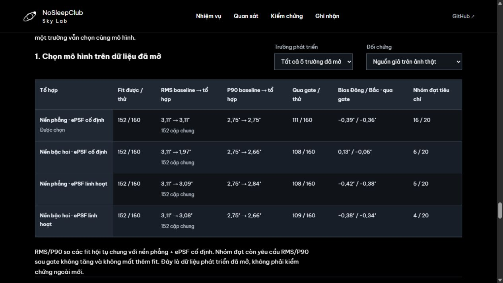
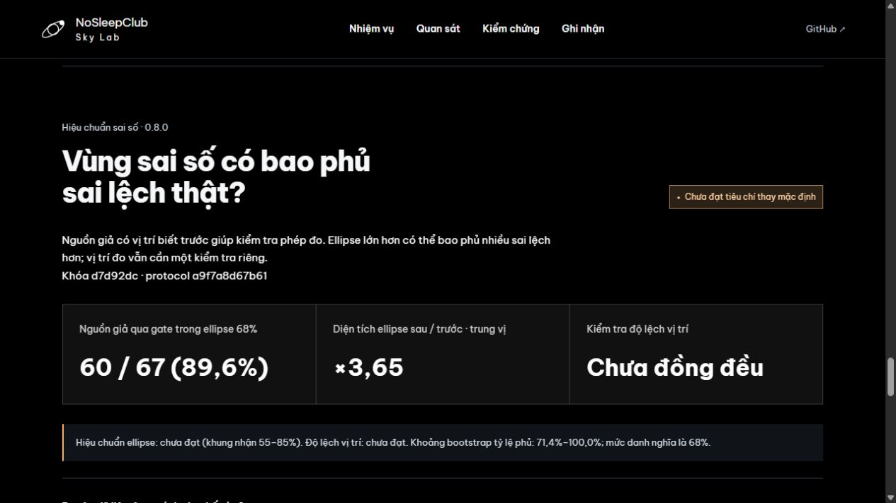
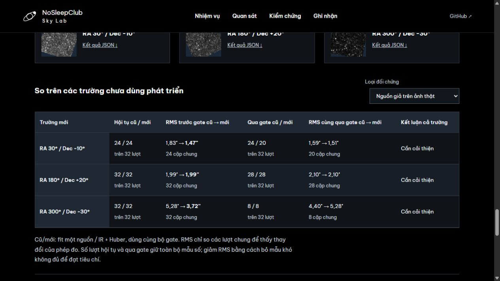

# nosleepclub_nasa_spherex

NoSleepClub · NASA Space Apps Challenge 2026 · [Planet X and SPHEREx](https://www.spaceappschallenge.org/2026/challenges/planet-x-and-spherex/?tab=details).

Web giúp so sánh ảnh SPHEREx theo thời gian, đánh dấu vùng sai khác và đưa cho con người kiểm tra.

**[Mở Sky Lab](https://nosleepclub-nasa-spherex.vercel.app)** · [Khám phá tọa độ](https://nosleepclub-nasa-spherex.vercel.app/#explore) · [Cách triển khai](docs/DEPLOYMENT.md) · [Kiểm nghiệm mới](docs/SHAPE_REFERENCE_RESULTS.md).

## Hiệu chỉnh PSF và sai số chung — checkpoint mới

**Mã nguồn riêng đã áp dụng [MIT](LICENSE)** theo lựa chọn của chủ repo ngày 31/10/2026. Font, ảnh Canva, dataset và dependency giữ điều kiện riêng trong [NOTICE](NOTICE.md).

**[Xem demo](https://nosleepclub-nasa-spherex.vercel.app/#shape-validation)** · [Kết quả, giới hạn và bước tiếp theo](docs/SHAPE_REFERENCE_RESULTS.md).

- Học ePSF từ **145/168** ô calibration, giữ 22 ô thiếu hỗ trợ và một ô từ chối số học. Cân bằng nguồn giảm đóng góp lớn nhất **50,70% → 12,87%**; hệ số được seal trước khi fit vị trí.
- Fit vị trí hoàn tất **146/168** ô, nhưng **hai sao có nghiệm cạnh tranh cách nhau 1,89″ và 3,38″**. Gate chặn mô hình: **252 ô dành riêng chưa đánh giá**, gồm 56 ô primary. Chưa áp dụng hiệu chỉnh hoặc chuyển ngưỡng nhận nguồn cũ sang PSF mới.
- Covariance baseline giữ **49.294 pixel** và sai số Gaia dùng chung: **357/420** ô có đáp ứng, 61 ô thiếu hỗ trợ và hai ô từ chối vẫn hiện. Heldout χ²/bậc tự do **407,431/238 ≈ 1,71**; sai số chưa được hiệu chuẩn đầy đủ.

Audit độc lập kiểm **357/357** đáp ứng native bằng QR và **1.314/1.314** hàm mục tiêu cuối của 146 fit mới bằng BVLS tại vị trí đã lưu. Đây là kiểm chứng số học, chưa phải độ chính xác thiên văn. Đăng ký cũ, tọa độ nguồn chồng, trọng số và một số sai số mô hình vẫn được giữ cố định; **30 trường triển vọng chưa mở**.

Web tách ba bước học → gate calibration → đánh giá dành riêng; báo rõ phần bị hoãn và giữ ca không có kết quả. Ba overview chỉ tải khi mở mục; các audit **2,48 / 3,06 / 2,72 MB gzip** là tải riêng. Bước tiếp theo là chẩn đoán hai nghiệm trong cùng exposure, kiểm giữ tín hiệu và lan truyền các phụ thuộc sai số còn thiếu trước kiểm định mới.

## Goal production đang thực hiện — 0.10

[Mở vùng trời](https://nosleepclub-nasa-spherex.vercel.app/#explore) · [Sao thật & nhận nguồn](https://nosleepclub-nasa-spherex.vercel.app/#reference-presence) · [20 tiêu chí nghiệm thu](docs/PRODUCTION_READINESS.md).

Luồng RA/Dec → metadata IRSA → cutout thật → so/nhấp nháy cùng thang hiển thị → xuất bằng chứng đã hoạt động. Năm mục tiêu của đề có hai cutout thật với nguồn, epoch và hash. Review khách riêng có ID ổn định, hết hạn, xóa theo ID, quota atomic và CI replica set thật; chưa có phân công chuyên gia hoặc chia sẻ nhận xét công khai.

**Đã kiểm tra 840 lượt sao thật và 7.992 mô phỏng có calibration/validation tách riêng.** Trên 21 sao Gaia đã mở × 20 ảnh × 2 ePSF, có **718 fit hoàn tất và 122 lượt lỗi chuẩn bị**, giữ đủ mẫu số. Cùng 359 cặp đo được, nội suy ePSF giảm RMS **0,934″ → 0,924″** nhưng tăng P90 **0,876″ → 0,942″**. Chưa chọn nó làm mô hình mới; hai sao không có kết quả vẫn hiện `0/20`.

Ngưỡng nhận nguồn **17,7038** được khóa trong Git sau 1.998 null calibration, trước 5.994 lượt validation riêng. Đây là điểm số, không phải sigma hay xác suất phát hiện.

| Validation trên một geometry đã mở | Chấp nhận /999 | Cận một phía 97,5% | Kết quả |
|---|---:|---:|---|
| Plane · không có mục tiêu | 0 | Báo nhầm ≤0,369% | Đạt điều kiện mô phỏng |
| Bậc hai · không có mục tiêu | 0 | Báo nhầm ≤0,369% | Đạt điều kiện mô phỏng |
| Plane · 600 µJy | 928 | Thu hồi ≥91,12% | Đạt ≥80% |
| Bậc hai · 600 µJy | 870 | Thu hồi ≥84,85% | Đạt ≥80% |
| Plane · 300 µJy | 46 | Thu hồi ≥3,39% | Chỉ báo cáo; phần lớn bị bỏ sót |
| Bậc hai · 300 µJy | 55 | Thu hồi ≥4,17% | Chỉ báo cáo; phần lớn bị bỏ sót |

**Chưa xác nhận false-alarm trên bầu trời thật hoặc hiệu chuẩn sai số chuyển động.** Tất cả mô phỏng dùng một bố cục đã mở, Gaussian khác family fitter và noise có điều kiện; scorer dùng VARIANCE quan sát, không dùng error oracle. Audit QR độc lập tính lại đủ 7.992 điểm số từ dữ liệu lưu; không sinh lại noise để chứng minh detector model.

[Báo cáo & giới hạn](docs/REFERENCE_PRESENCE_RESULTS.md) · [Protocol sao thật](docs/REFERENCE_STAR_PROTOCOL.md) · [Protocol nhận nguồn](docs/SOURCE_PRESENCE_PROTOCOL.md) · [Overview sao thật](web/data/reference-stars/overview.json) · [Overview mô phỏng](web/data/source-presence/overview.json). Các audit đầy đủ có SHA và link tải riêng: **14,2 MB / 71,1 MB gzip**; web chỉ tự tải hai overview khi mở mục mới.

[Đối chứng nguồn chồng trước](docs/NEIGHBOR_INTERVENTION_RESULTS.md) giữ đủ 288 lượt, kể cả một draw qua số học vẫn lệch **16,8″**. Không bỏ failure đó hoặc chọn NNLS chỉ từ các ca thuận lợi. Linked-flux và các sản phẩm khoa học cũ vẫn giữ nguyên.

**Chưa đạt nghiệm thu khoa học/production.** [Study linked-flux trước](docs/WISE_LINKED_RESULTS.md) giữ đủ 28 fit và nghiệm cạnh tranh; [ePSF liên tục](docs/CONTINUOUS_EPSF_RESULTS.md) ổn định Hessian nhưng RMS không giảm ở cả sáu ca; [sandwich covariance](docs/SANDWICH_RESULTS.md) vẫn thiếu phủ ở nguồn mờ. Không ghi đè các sản phẩm 0.3–0.9 hoặc gọi chúng là kiểm định chưa mở.

[Time model](docs/ASTROMETRIC_TIME_MODEL.md) kiểm 31 header và rank GLS nhưng chưa nối vào fit nguồn. [Phổ độc lập](docs/SPECTRAL_REFERENCE_RESULTS.md), [mask](docs/SCIENCE_MASK_AUDIT.md), [gain](docs/NATIVE_GAIN_BINDING.md) và [quy ước photometry](docs/PHOTOMETRIC_CONVENTION_AUDIT.md) giữ đơn vị, UUID/hash và giả định chưa kiểm chứng. IRSA cho phép ePSF mới với QR2 cũ; residual/bias của renderer hiện tại vẫn phải đo riêng.

**API review đạt baseline tải nhỏ:** [60/60 request](docs/REVIEW_LOAD_RESULTS.md), 12/12 phiên QA xác minh sạch; p95 GET **1,937 s**, POST **0,203 s**, DELETE **0,141 s**. Protocol `d7fd8f9` khóa trước đo trên production `8032493`, tối đa ba request đồng thời, cách đợt ít nhất sáu giây. Chưa chứng minh SLO, saturation, failover hoặc recovery production. [Runbook](docs/OPERATIONS.md) giữ cả lịch sử lỗi 502/504.

**Bản public đã xác minh trước checkpoint này: [PR #11](https://github.com/dakiemdarktharr/nosleepclub_nasa_spherex/pull/11), main `1149210`.** [CI](docs/evidence/0.10/ci-pr11-8c124d1.json) chạy 453 ca Python (13 optional raw-cache/photutils skip), sáu ca Mongo replica set thật và năm suite Node. [62 phản hồi public](docs/evidence/0.10/production-1149210.json) xác minh 48 artifact theo Git, commit cả ba API và cleanup QA, không cần retry upstream. [Biên nhận phát hành](docs/REFERENCE_PRESENCE_RELEASE.md) tách rõ software verification và các gate khoa học chưa đạt. Lịch sử lỗi đóng gói/upstream vẫn nằm trong [runbook](docs/OPERATIONS.md).

Bước học ePSF và covariance baseline đã có kết quả ở checkpoint mới phía trên. Tiếp theo cần giải thích các nghiệm cạnh tranh, kiểm giữ tín hiệu và hoàn thiện covariance trước đánh giá ngoài. Khả năng giảm bias vẫn chưa được chứng minh. Chưa áp dụng gate mô phỏng này để xác nhận nguồn trong workspace. [30 tâm trường dành trước](docs/INDEPENDENT_FIELD_SELECTION.md) vẫn chưa query/đo: **12 calibration / 12 validation / 6 final holdout**. Khóa evaluator, power, miền hỗ trợ, gate và overlap trước khi mở.

[Mã nguồn riêng theo MIT](LICENSE). [Nguồn và quyền sử dụng](NOTICE.md) ghi điều kiện riêng của font, dữ liệu, minh họa Canva và dependency; các tài sản này không được cấp lại theo MIT.

## Bắt đầu trên web

1. Chọn **Bắt đầu quan sát**. Kéo vạch trước/sau hoặc bật **Nhấp nháy** để tìm điểm đổi vị trí.
2. Mở **Kiểm chứng** để xem sai lệch phục hồi, số fit lỗi và giới hạn của kết quả.
3. Chọn **Ghi nhận**, lưu điều bạn thấy; có thể chọn **Tôi chưa chắc**, xuất JSON hoặc xóa nhận xét.

Nút **Hướng dẫn 60 giây** giải thích sao lùn nâu, pixel, ellipse sai số và cách đọc ảnh. Người có kinh nghiệm có thể mở bảng tọa độ, dữ liệu Gaia, FITS và cấu hình đầy đủ.

## Tách thử nền/ePSF và covariance theo nhóm — 0.9.0

So bốn tổ hợp trên **5 trường đã mở**, cùng pixel/căn chỉnh/gate. **Giữ nền phẳng + ePSF cố định**: nền bậc hai giảm pooled RMS 3,110→1,967″ nhưng chỉ đạt 8/25 nhóm, không đủ ổn định để thay baseline. Cả 5 lần bỏ một trường đều giữ lựa chọn đơn giản.

Lựa chọn/ngưỡng nền khóa ở `1f1dae2`; covariance học từ **192** ca calibration riêng, tách vùng học floor và scale, gộp nhóm ít mẫu. Seal `8c7ad54` trước **135 cutout QR2** tại ba trường mới. S/N/nền dùng đặc trưng quan sát; không dùng truth để chọn nhóm. Ngoài miền thì không cấp covariance hiệu chuẩn.

| Kiểm định 96 nguồn giả | Hiệu chuẩn chung | Theo S/N và nền |
|---|---:|---:|
| Qua quality gate, cùng miền hỗ trợ | 69/96 | 69/96 |
| Phủ ellipse 68%, trên 69 mẫu | 54/69 (78,3%) | 57/69 (82,6%) |
| Diện tích ellipse trung vị / raw | ×5,15 | ×2,23 |

**Chưa qua gate tổng.** Ba trong bốn ô quá phủ; theo trường là 100%, 83,9%, 12,5%. Trường cuối chỉ còn một vùng nền với 8 ca tương quan, sai lệch vẫn 1,19–2,95″. Demo đánh dấu vùng cần người xem lại trên ảnh gốc, tách rõ nguồn giả khỏi thiên thể thật. Sao Gaia có 18/23 ca qua gate nằm ngoài miền covariance nên được báo từ chối ngoại suy.

**95/95 kiểm thử offline đạt.** [Phương pháp, lựa chọn, kết quả và giới hạn](docs/ABLATION_VALIDATION.md). Số đo WISE 0855 vẫn giữ nguyên; chưa xác nhận chuyển động. Bước tiếp theo: chẩn đoán bias/nguồn chồng ở tập đã mở và bổ sung calibration theo trường trước khi khóa một tập ngoài mới.



## Nền ảnh/ePSF và hiệu chuẩn covariance — 0.8.0

Thử nền bậc hai và độ rộng ePSF linh hoạt, tách **phát triển / calibration / validation** theo trường và exposure. Thiết kế khóa ở `4e7a50c`; error floor học từ **192** nguồn giả trên ba trường đã mở, rồi khóa calibrator ở `d7d92dc` trước khi fit **122 cutout QR2** của ba trường mới. Tập kiểm định có 96 nguồn giả và 33 sao Gaia giữ ngoài căn chỉnh.

| Trường RA/Dec | RMS nguồn giả cũ → mới, cặp chung | Qua gate /32 | Phủ 68% thô → hiệu chuẩn |
|---|---:|---:|---:|
| 60° / −30° | 0,945 → 0,993″ | 32 | 24/32 → 32/32 |
| 150° / +45° | 1,368 → 1,418″ | 21 | 9/21 → 18/21 |
| 330° / +10° | 3,096 → 2,843″ | 14 | 0/14 → 10/14 |

**Chưa đạt tiêu chí thay mặc định.** Pooled RMS giảm 2,079→1,961″ nhưng P90 tăng và hai trường tăng RMS. Trên 67/96 mẫu qua gate, ellipse danh nghĩa 68% phủ **49,3%→89,6%**, với diện tích trung vị ×**3,65**; mức phủ mới quá cao so với tiêu chí đã khóa. Hiệu chuẩn không thay centroid, không xác nhận chuyển động và chưa được áp dụng lên WISE 0855.

Demo tách RMS/bias khỏi độ phủ và mức nới ellipse, chuyển được giữa nguồn giả và sao Gaia, có protocol/hash và giới hạn. **73/73 kiểm thử offline đạt**; MongoDB production được kiểm tra riêng bằng review QA của bài test.

[Phương pháp, audit, kết quả và bước tiếp theo](docs/COVARIANCE_VALIDATION.md). Mốc tiếp theo là ablation nền/ePSF trên dữ liệu đã mở, chọn point model rồi hiệu chuẩn theo S/N/nền trước một tập ngoài mới.



## Quality gate và nguồn chồng — 0.7.0

Thêm mô hình hàng xóm CatWISE/Gaia, hai vòng giảm trọng số Huber cho pixel outlier và gate kiểm tra residual, lõi ảnh, suy biến nguồn chồng, bất đồng centroid giữa hai mô hình. Căn chỉnh từ chối outlier theo median/MAD và vẫn cần ít nhất 4 sao.

Code, catalog, chia mẫu và rule được khóa tại **`330449c`** trước khi đánh giá ba trường mới: **115 cutout QR2**, 58 exposure ghép phổ, 33 sao heldout và 96 tình huống nguồn giả qua hai họ ePSF.

| Trường RA/Dec | RMS nguồn giả trên cặp chung, trước gate | Qua gate cũ → mới /32 |
|---|---:|---:|
| 30° / −10° | 1,826 → 1,471″ | 24 → 20 |
| 180° / +20° | 1,989 → 1,991″ | 28 → 28 |
| 300° / −30° | 5,279 → 3,725″ | 8 → 8 |

**Chưa đạt tiêu chí thay mặc định.** Hai trường giảm RMS nguồn giả ở điểm ước lượng, nhưng sai lệch sao thật xấu hơn ở hai trường; nhóm cùng qua gate ở trường cuối còn tăng RMS 4,397→5,282″. Chỉ 8/56 nguồn giả được nhận nằm trong ellipse danh nghĩa 68%, nên chưa có ngân sách sai số được hiệu chuẩn.

Trên các trường phát triển đã mở, outlier 6,309″ giảm xuống 0,283″ nhưng vẫn bị gate loại; một ca RW Aur có residual nhỏ mà lệch hơn bị gate bất đồng chặn. Demo cho xem lý do từ chối và số lượt trước/sau gate. Với bộ ảnh WISE 0855 cũ, UI chỉ kiểm tra cơ bản từ dữ liệu đã xuất và ghi rõ chưa chạy gate mới đầy đủ; số đo khoa học giữ nguyên.

[Phương pháp, kết quả theo trường/độ sáng, giới hạn và cách tái tạo](docs/QUALITY_VALIDATION.md). 59/59 kiểm thử offline đạt; đây là kiểm chứng phần mềm và dữ liệu, không phải xác nhận phát hiện thiên văn.



## Kiểm tra ngoài trường trước đó — 0.6.0

Đã tải **129 cutout QR2** ở ba trường Barnard’s Star, RW Aur và R Draconis, đối chiếu **6.736 hàng Gaia DR3**. Khóa code/dataset/chia mẫu tại commit `8aa2536` trước khi đo. Không thay số đo WISE 0855.

| Trường, phổ rộng | Sao giữ ngoài đo được / thử | RMS lệch vector so Gaia | Nguồn giả fit được / thử | RMS nguồn giả hợp lệ |
|---|---:|---:|---:|---:|
| Barnard | 11/11 | 1,921″ | 15/16 | 2,103″ |
| RW Aur | 11/11 | 0,182″ | 13/16 | 6,009″ |
| R Dra | Chưa đo được | Chỉ 3 sao căn chỉnh, cần ≥4 | — | — |


Barnard có một outlier Gaia **6,309″**. Chính mục tiêu Barnard lệch dự báo **2,628″**, χ²r rất cao dù solver hội tụ. Nguồn mờ trên nền RW Aur phục hồi kém hơn nhiều so với sao Gaia sáng. Phổ chặt/rộng Barnard dùng đúng cùng cặp ảnh; không tính là hai kiểm chứng độc lập.

**Chưa có tỷ lệ chính xác chung hoặc precision/recall tìm kiếm mù.** Đây là kiểm tra local fitting ở vị trí đã biết; 32 tình huống nguồn giả duy nhất, dùng cùng họ ePSF với fitter và ngân sách ellipse còn thiếu hệ thống. [Dataset, phương pháp, kết quả theo độ sáng và cách tái tạo](docs/EXTERNAL_BENCHMARK.md).

## Giao diện dễ đọc

- Dùng **Be Vietnam Pro** ở năm độ đậm 400–800, gồm bộ ký tự Vietnamese và Latin. Font WOFF2 được phục vụ ngay từ repo, dùng được khi mở demo offline; không gọi dịch vụ font bên ngoài lúc chạy.
- Tăng khoảng cách dòng để dấu tiếng Việt không bị cắt. Bảng, chỉ dẫn và nhãn điều khiển dùng cỡ chữ lớn hơn trên desktop/mobile.
- Chữ trên ảnh có nền tối đặc và viền riêng; chữ biểu đồ sáng hơn. Các cặp màu chính đã kiểm tra có tương phản trên 10:1.
- Tách phần mô tả, nút và dải thông tin đầu trang theo luồng bố cục, tránh chồng nội dung khi chữ xuống dòng. Nhận xét không bị giữ ngoài màn hình ở viewport thấp.

[Chi tiết kiểm tra độ dễ đọc](docs/READABILITY.md) · [Nguồn font](https://github.com/google/fonts/tree/main/ofl/bevietnampro) · [Giấy phép SIL OFL](web/assets/fonts/OFL.txt).

**Kiểm chứng 0.5.0:** [QR3/CatWISE/ePSF và 30 vùng khóa trước](docs/QR3_CATWISE_VALIDATION.md). QR3 chưa phủ tọa độ truy vấn ở cả SIA và TAP. Đã bổ sung catalog IR có hiệu chỉnh tile, so ba mô hình bằng 1.440 phép phục hồi; phổ rộng có điểm ước lượng tốt hơn, chưa mô hình nào qua gate ở cả hai cấu hình. Giữ phép đo cũ làm mặc định. Minh họa Canva luôn tách rõ khỏi FITS thật.

| Thành phần | Phiên bản | Vai trò |
|---|---|---|
| Explorer và kiểm chứng hiện tại | 0.10 | RA/Dec, chuỗi ảnh thật, review riêng, chẩn đoán ePSF/covariance; chưa đạt nghiệm thu khoa học |
| Chọn mô hình theo nhóm | 0.9.0 | Ablation 2×2, covariance theo S/N/nền; giữ trong lịch sử, chưa qua gate tổng |
| Hiệu chuẩn covariance chung | 0.8.0 | Đối chứng lịch sử; không thay mặc định |
| Quality gate và deblend | 0.7.0 | Baseline cho thí nghiệm 0.8; chưa thay mặc định |
| Benchmark ngoài trường trước đó | 0.6.0 | Baseline để phân tích lỗi và phát triển gate |
| Thí nghiệm catalog IR/ePSF | 0.5.0 | 30 vùng khóa trước; chưa thay số đo mặc định |
| Phép đo mặc định | 0.3.0 | Pixel gốc, căn chỉnh Gaia; chuyển động chưa xác nhận |

## Demo hiện tại: WISE 0855


- Giữ cùng 20 exposure của bản cộng ảnh, mở cutout từ 0,12° lên 0,32° và đối chiếu 675 nguồn Gaia DR3.
- Chọn 21 sao đạt chất lượng: 14 sao căn chỉnh, 7 sao giữ ngoài fit. Lan truyền vị trí/proper motion/parallax và covariance Gaia đến ngày quan sát.
- Cấu hình phổ rộng: **3,29″ ± 0,52″** trong 163,5 ngày; đổi tập sao làm vector đổi **0,04″**, bỏ từng sao lớn nhất **0,17″**, thử affine **0,10″**. Đây là sai số theo mô hình có điều kiện.
- Bản đồ Gaia tương tác, bảng ngân sách sai số, kiểm tra nguồn giả tại 8 vị trí/hai độ sáng; giữ cả hai cấu hình trước Gaia và ba cặp ảnh đơn cũ.
- So sánh kéo vạch, song song, sai khác và nhấp nháy; zoom, highlight và bảng bằng chứng.
- Nhận xét production lưu MongoDB theo phiên trình duyệt; có local fallback, xuất JSON và xóa theo vùng.
- Hướng dẫn thao tác ngắn trong giao diện; phương pháp/giới hạn đầy đủ mở theo nhu cầu. Bảng A/B có bộ lọc phổ và ePSF, cùng bản đồ 30 vùng kiểm thử.
- FITS đã xử lý, arrays và manifest có nguồn, hash và phiên bản để kiểm tra lại.


**Dấu hiệu chuyển động, chưa xác nhận.** Phổ chặt là cấu hình chính: **3,06″ ± 0,99″**; phổ rộng là kiểm tra độ nhạy và dùng chung một phần ảnh. Nguồn giả đứng yên cùng độ sáng trên tám nền ảnh khác vẫn có RMS lệch **2,72″** ở cấu hình rộng; nguồn dịch chuyển bằng nửa độ sáng chỉ có **2/8** lượt nằm trong ellipse sai số 68%. Vector rộng còn chênh **1,21″** so với dự báo ngoài. Gaia làm rõ độ ổn định của frame, chưa giải quyết toàn bộ blending, ePSF và đáp ứng phổ. Chưa có vision model được huấn luyện.

## Mở bộ ảnh demo offline

Ứng dụng dùng các sản phẩm nhỏ đã có sẵn trong repo; chỉ cần Python để mở, không cần Node hoặc tải lại dữ liệu.

```sh
git clone https://github.com/dakiemdarktharr/nosleepclub_nasa_spherex.git
cd nosleepclub_nasa_spherex
python scripts/serve_demo.py
```

Mở **http://127.0.0.1:8766**. Có thể đổi cổng bằng `--port 8767`. Server chỉ phục vụ thư mục `web/`, bind vào localhost. Các tệp trong `web/` cũng có thể được phục vụ bằng static hosting có hỗ trợ JSON/PNG/FITS.

## Tái tạo kết quả khoa học

Python 3.11 trở lên; nên dùng virtual environment. Các phiên bản trong `requirements.txt` là phiên bản đã chạy trên máy phát triển.

```sh
python -m venv .venv
.venv\Scripts\python -m pip install -r requirements.txt
# Thêm dependency API và kiểm thử vận hành để chạy toàn bộ suite:
.venv\Scripts\python -m pip install -r web/requirements.txt -r requirements-ops.txt
.venv\Scripts\python scripts/fetch_wise0855.py
.venv\Scripts\python scripts/fetch_wise0855.py --demo
.venv\Scripts\python scripts/build_demo.py
.venv\Scripts\python scripts/prepare_motion_data.py
.venv\Scripts\python scripts/motion_analysis.py
.venv\Scripts\python scripts/prepare_gaia_data.py
.venv\Scripts\python scripts/gaia_motion.py --publish
.venv\Scripts\python -m unittest discover -s tests -v
```

Lệnh `--demo` tải 6 cutout được chọn và kiểm tra FITS; lưu trong `data/raw/wise0855/target-centered/`. Chạy fetch không có `--demo` để quét các quan sát D6 trong vùng truy vấn ban đầu, hiện đã kiểm tra 43 quan sát. Download có cache và giới hạn 3 request đồng thời.

`prepare_motion_data.py` chọn 31 cutout trong hai cửa sổ epoch, tải lại quanh mục tiêu và lấy hai tệp hiệu chuẩn chính thức đã ghim phiên bản/hash. Phân tích dùng 2 hoặc 10 cặp phù hợp phổ; không dùng tất cả 31 ảnh để cộng. `motion_analysis.py` chạy 128 mô phỏng noise mỗi epoch/cấu hình, xuất covariance, đối chứng và hai bộ sản phẩm web. Chạy `build_demo.py` trước rồi `motion_analysis.py` để manifest chứa cả ảnh đơn và ảnh cộng. Test chạy offline; chỉ kiểm tra hash raw khi có cache.

`prepare_gaia_data.py` tải cutout rộng của đúng 20 exposure cũ và truy vấn Gaia DR3 qua IRSA TAP, lưu ADQL/URL/hash. `gaia_motion.py --publish` cache centroid sao tham chiếu, chạy đổi tập sao, 14 lượt bỏ từng sao, affine, 256 bootstrap căn chỉnh và 32 injection mỗi cấu hình; sau đó thêm sản phẩm Gaia vào demo. Chạy các bước theo thứ tự trên nếu tái tạo toàn bộ manifest. 31 kiểm thử kiểm tra cả các sản phẩm đã commit mà không cần tải raw.

Thí nghiệm 0.4.0: `python -m scripts.joint_motion --configuration broad`, lặp lại với `strict`, rồi `python -m scripts.summarize_joint`. 192 phép phục hồi nguồn giả và 128 bootstrap/epoch/mô hình. Fit nhiều nguồn chưa cải thiện đồng đều; **chưa thay bản 0.3.0 làm mặc định**. Xem RMS, số fit lỗi và so sánh ghép cặp trong tài liệu accuracy. Ở checkpoint 0.7, suite có 59 kiểm thử offline. CI và báo cáo theo phiên bản ghi kết quả mới nhất; số ca lịch sử không phải số ca hiện tại.

Benchmark 0.6.0: `python -m scripts.prepare_benchmark_data --download`, rồi `python -m scripts.benchmark_accuracy`. Cần calibration D6 của quy trình trước. Protocol đã có trong repo; script kiểm tra hash và từ chối thay nguồn đã khóa. Xem báo cáo trước khi diễn giải số đo hoặc tạo tập kiểm chứng mới.

Quality study 0.7.0: `python -m scripts.prepare_quality_data`, `python -m scripts.prepare_quality_data --new`, rồi `python -m scripts.quality_study` và `python -m scripts.build_quality_overview`. Dùng protocol đã commit; không chạy `--lock` đè lên tập đã mở. Đọc báo cáo để tách kết quả phát triển, đánh giá mới và các giới hạn covariance.

## Tài liệu

- [Quality gate, nguồn chồng và đánh giá khóa trước 0.7.0](docs/QUALITY_VALIDATION.md)
- [Benchmark ba trường mới: dataset, độ chính xác và các lỗi](docs/EXTERNAL_BENCHMARK.md)
- [QR3, CatWISE, ePSF và 30 vùng khóa trước](docs/QR3_CATWISE_VALIDATION.md)
- [Font tiếng Việt, tương phản và bố cục](docs/READABILITY.md)
- [Thiết kế luồng cho người mới](docs/UI_DESIGN.md)
- [Thí nghiệm nhiều nguồn 0.4.0](docs/ACCURACY_RESEARCH.md)
- [Gaia, độ ổn định vector, sai số và milestone tiếp theo](docs/WISE0855_GAIA.md)
- [Research cải thiện công cụ và danh mục nhập Zotero](docs/GAIA_RESEARCH.md)
- [Bản cộng ảnh trước Gaia](docs/WISE0855_COADD.md)
- [Baseline ba cặp ảnh đơn ban đầu](docs/WISE0855_DEMO.md)
- [Phân tích vision model và quy trình review](docs/DEEP_RESEARCH_VISION.md)
- [Tóm tắt đề bài](docs/CHALLENGE.md)
- [Lộ trình](docs/ROADMAP.md)
- [Hướng dẫn đóng góp](CONTRIBUTING.md)

## Dữ liệu và giấy phép

Dữ liệu gốc: SPHEREx QR2 tại NASA/IPAC IRSA, DOI [10.26131/IRSA652](https://doi.org/10.26131/IRSA652). Các PNG/FITS trong `web/data/` là sản phẩm xử lý phục vụ demo, không phải sản phẩm khoa học chính thức của IRSA. Manifest giữ URL cutout, SHA-256, observation ID và pipeline version.

Không commit token hoặc bộ FITS thô lớn. Mã nguồn riêng và tài liệu gốc đi kèm được cấp phép theo [MIT](LICENSE), theo lựa chọn của chủ repo ngày 31/10/2026. Dữ liệu, font, minh họa Canva và dependency giữ điều kiện sử dụng riêng trong [NOTICE](NOTICE.md).

Font Be Vietnam Pro được phân phối theo SIL Open Font License 1.1, kèm giấy phép và SHA-256 trong `web/assets/fonts/`. Script `python scripts/fetch_web_fonts.py` chỉ dùng khi cần lấy lại font từ nguồn chính thức; clone repo để chạy web không cần bước này.
