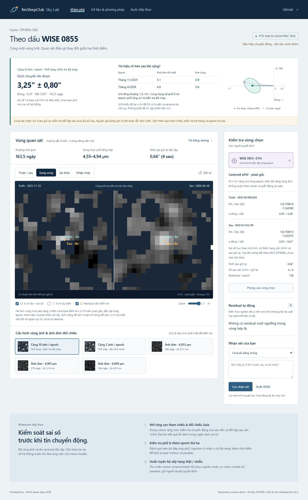

# nosleepclub_nasa_spherex

NoSleepClub · NASA Space Apps Challenge 2026 · [Planet X and SPHEREx](https://www.spaceappschallenge.org/2026/challenges/planet-x-and-spherex/?tab=details).

Web giúp so sánh ảnh SPHEREx theo thời gian, đánh dấu vùng sai khác và đưa cho con người kiểm tra.

## Demo hiện tại: WISE 0855



- Cộng 10 ảnh mỗi epoch theo các cặp phổ tương thích, cùng trọng số phổ ở hai epoch; thêm cấu hình phổ chặt 2 ảnh để đối chiếu và giữ ba cặp ảnh đơn cũ.
- S/N khẩu độ trước/sau: **5,1 → 7,9** và **4,6 → 7,6**. Fit centroid độc lập trên pixel gốc cho dịch chuyển **3,25″ ± 0,80″** trong 163,5 ngày ở cấu hình phổ rộng; sai số theo mô hình có điều kiện.
- So sánh kéo vạch, song song, sai khác và nhấp nháy; zoom, highlight và bảng bằng chứng.
- Lưu/xuất nhận xét trong trình duyệt; có thể xóa nhận xét theo vùng.
- FITS đã xử lý, arrays và manifest có nguồn, hash và phiên bản để kiểm tra lại.

**Dấu hiệu chuyển động, chưa xác nhận.** Cấu hình phổ chặt là cấu hình chính: **3,25″ ± 1,05″**, S/N không tăng rõ. Cấu hình phổ rộng là kiểm tra độ nhạy, có dùng chung ảnh với cấu hình chặt. Chỉ 3–4 sao kiểm tra độc lập, chưa đổi chéo được tập sao căn chỉnh; nguồn giả đứng yên trên nền khác vẫn có độ lệch 0,89″ ở cấu hình rộng. Chưa neo Gaia hoặc kiểm tra toàn bộ đáp ứng phổ. Baseline hiện dùng xử lý ảnh và ePSF, chưa có vision model được huấn luyện.

## Mở demo ngay

Ứng dụng dùng các sản phẩm nhỏ đã có sẵn trong repo; chỉ cần Python để mở, không cần Node hoặc tải lại dữ liệu.

```sh
git clone https://github.com/dakiemdarktharr/nosleepclub_nasa_spherex.git
cd nosleepclub_nasa_spherex
python scripts/serve_demo.py
```

Mở **http://127.0.0.1:8766**. Có thể đổi cổng bằng `--port 8767`. Server chỉ phục vụ thư mục `web/`, bind vào localhost. Các tệp trong `web/` cũng có thể được phục vụ bằng static hosting có hỗ trợ JSON/PNG/FITS.

## Tái tạo kết quả khoa học

Python 3.11 trở lên; nên dùng virtual environment. Các phiên bản trong `requirements.txt` là phiên bản đã chạy trên máy phát triển.

```sh
python -m venv .venv
.venv\Scripts\python -m pip install -r requirements.txt
.venv\Scripts\python scripts/fetch_wise0855.py
.venv\Scripts\python scripts/fetch_wise0855.py --demo
.venv\Scripts\python scripts/build_demo.py
.venv\Scripts\python scripts/prepare_motion_data.py
.venv\Scripts\python scripts/motion_analysis.py
.venv\Scripts\python -m unittest discover -s tests -v
```

Lệnh `--demo` tải 6 cutout được chọn và kiểm tra FITS; lưu trong `data/raw/wise0855/target-centered/`. Chạy fetch không có `--demo` để quét các quan sát D6 trong vùng truy vấn ban đầu, hiện đã kiểm tra 43 quan sát. Download có cache và giới hạn 3 request đồng thời.

`prepare_motion_data.py` chọn 31 cutout trong hai cửa sổ epoch, tải lại quanh mục tiêu và lấy hai tệp hiệu chuẩn chính thức đã ghim phiên bản/hash. Phân tích dùng 2 hoặc 10 cặp phù hợp phổ; không dùng tất cả 31 ảnh để cộng. `motion_analysis.py` chạy 128 mô phỏng noise mỗi epoch/cấu hình, xuất covariance, đối chứng và hai bộ sản phẩm web. Chạy `build_demo.py` trước rồi `motion_analysis.py` để manifest chứa cả ảnh đơn và ảnh cộng. Test chạy offline; chỉ kiểm tra hash raw khi có cache.

## Tài liệu

- [Cộng ảnh, astrometry, sai số và bước tiếp theo hiện tại](docs/WISE0855_COADD.md)
- [Baseline ba cặp ảnh đơn ban đầu](docs/WISE0855_DEMO.md)
- [Phân tích vision model và quy trình review](docs/DEEP_RESEARCH_VISION.md)
- [Tóm tắt đề bài](docs/CHALLENGE.md)
- [Lộ trình](docs/ROADMAP.md)
- [Hướng dẫn đóng góp](CONTRIBUTING.md)

## Dữ liệu và giấy phép

Dữ liệu gốc: SPHEREx QR2 tại NASA/IPAC IRSA, DOI [10.26131/IRSA652](https://doi.org/10.26131/IRSA652). Các PNG/FITS trong `web/data/` là sản phẩm xử lý phục vụ demo, không phải sản phẩm khoa học chính thức của IRSA. Manifest giữ URL cutout, SHA-256, observation ID và pipeline version.

Không commit token hoặc bộ FITS thô lớn. Repo hiện chưa cấp giấy phép mã nguồn; cần thống nhất giấy phép của nhóm. Dữ liệu và tài sản bên thứ ba giữ điều kiện sử dụng riêng.
