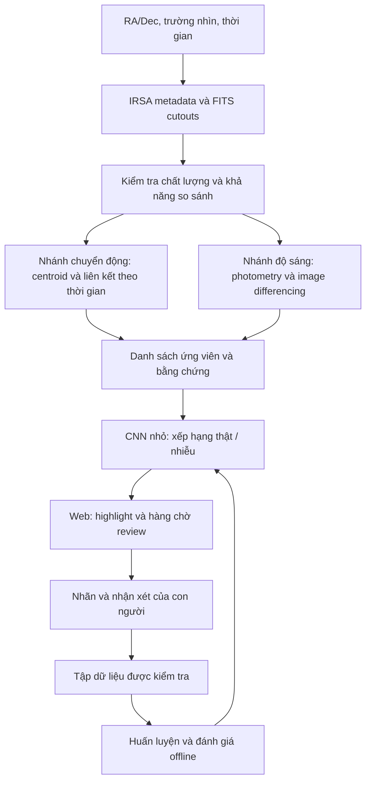

# SPHEREx Change Explorer — phân tích kỹ thuật và hướng triển khai

Ngày nghiên cứu: **30/10/2026**. Tài liệu thiết kế; chưa phải báo cáo về một mô hình đã huấn luyện hoặc một pipeline đã chạy thành công trên dữ liệu.

Ghi chú tiến độ: đây là bản nghiên cứu trước khi triển khai. Bản demo cutout thật và các phép đo thực hiện sau đó được ghi riêng trong [WISE0855_DEMO.md](WISE0855_DEMO.md); dùng tài liệu đó để xem trạng thái sản phẩm hiện tại.

## Quyết định đề xuất

Xây dựng web giúp người dùng xem một vùng trời theo thời gian, nhận các vùng thay đổi được đánh dấu, rồi kiểm tra bằng chứng và đưa ra nhận xét. Thiết kế gồm ba thành phần:

1. Pipeline thiên văn chuẩn bị các quan sát có thể so sánh và tạo ứng viên.
2. Một CNN nhỏ xếp hạng ứng viên theo dấu hiệu thật/nhiễu.
3. Không gian review hiển thị ảnh, phép đo, cảnh báo chất lượng và lịch sử quyết định.

Mô hình chạy trực tiếp trong trình duyệt là một đích khả thi về kiến trúc. Xử lý FITS và kiểm chứng khoa học vẫn đặt ở backend. Việc chạy được model trên web không tự chứng minh model có giá trị trên SPHEREx.

## 1. Phạm vi đề bài và phạm vi sản phẩm

[Đề chính thức](https://www.spaceappschallenge.org/2026/challenges/planet-x-and-spherex/?tab=details) yêu cầu web công khai, nhập RA/Dec và xem chuỗi ảnh cùng vùng trời theo thời gian. Các mục tiêu kiểm thử là Barnard’s Star, Epsilon Indi B, WISE 0855, RW Aurigae và R Draconis. AI là phần mở rộng do nhóm đề xuất.

Sản phẩm đề xuất ưu tiên ba tình huống:

| Tình huống | Bằng chứng cần trình bày | Kết luận ban đầu phù hợp |
| --- | --- | --- |
| Nguồn đổi vị trí | Tọa độ qua các epoch, sai số, độ khớp với nền sao | Ứng viên chuyển động |
| Nguồn đổi độ sáng | Flux và sai số trong passband tương thích, light curve | Ứng viên biến quang |
| Nguồn xuất hiện/biến mất | Phát hiện mới và giới hạn phát hiện ở ảnh còn lại | Ứng viên transient hoặc thiếu dữ liệu cần kiểm tra |

Không tự kết luận "Planet X" từ một vùng sáng khác biệt. Không có đối sánh catalog chỉ có nghĩa là chưa tìm thấy đối sánh theo truy vấn hiện tại.

## 2. Dữ liệu đã có, nhưng cần kiểm tra khả năng so sánh

IRSA đã phát hành QR2 và bắt đầu QR3 trong tháng 9/2026. [Thông báo IRSA](https://irsa.ipac.caltech.edu/newsletter/2026/IRSA_NL_2026_08.html) nêu QR3 cải thiện PSF và các hiệu chuẩn liên quan. Việc tab Resources của cuộc thi chưa mở không đồng nghĩa dữ liệu SPHEREx chưa công khai.

[Tài liệu truy cập IRSA](https://caltech-ipac.github.io/spherex-archive-documentation/spherex-data-access/) mô tả SIA2, PyVO/Astroquery và dịch vụ cutout. Luồng lấy dữ liệu đề xuất:

1. Tìm metadata theo vùng trời, thời gian và collection.
2. Lấy `access_url` của quan sát phù hợp, rồi yêu cầu cutout.
3. Giữ định danh quan sát, release và phiên bản xử lý trong manifest.
4. Tải có cache, giới hạn đồng thời và khả năng tiếp tục khi lỗi.

Không hardcode danh sách tệp từ một ví dụ tài liệu. Không coi cùng một exposure được xử lý ở QR2 và QR3 là hai epoch độc lập.

### Kiểm tra metadata trực tiếp đã thực hiện

Ngày 30/10/2026, đã gửi truy vấn SIA2 tới vùng RA `133.79512917°`, Dec `−7.24514722°`, bán kính `0.05°` (3 arcmin), tính từ tọa độ WISE 0855 trong đề. Hai response HTTP 200 dùng TABLEDATA, `QUERY_STATUS=OK`:

| Collection truy vấn | Số bản ghi metadata | Khoảng `t_min` trả về, MJD |
| --- | --- | --- |
| `spherex_qr2` | 278 | 60800.700028–61174.287218 |
| `spherex_qr3` | 0 | Không có trong kết quả truy vấn này |

Đã lưu [bằng chứng truy vấn](irsa-wise0855-metadata-check.json). Đây là số bản ghi của vùng trời; không phải số epoch độc lập hay số phát hiện WISE 0855. Chưa tải FITS, chưa truyền vị trí nguồn theo proper motion, chưa kiểm tra passband tại pixel mục tiêu. QR3 mới hơn không đồng nghĩa QR3 đã có dữ liệu phù hợp ở mọi vùng cần demo.

### Rủi ro chính: màu phổ dễ bị nhầm là thay đổi thời gian

SPHEREx dùng **linear variable filter**: bước sóng phụ thuộc vị trí trên detector. Phổ đầy đủ được tích lũy qua nhiều exposure; không thể mặc định mỗi timestamp chứa sẵn 102 ảnh đồng bộ. [Giải thích của đội SPHEREx](https://spherex.caltech.edu/page/survey).

Hệ quả thiết kế: ghép ảnh theo bước sóng/bandwidth tại vùng ứng viên, không chỉ theo detector ID. Nếu không có quan sát tương thích, giao diện vẫn cho xem ảnh nhưng pipeline phải từ chối kết luận biến quang. Gộp theo detector chỉ được xem là sản phẩm khám phá có giả định phổ được công bố.

## 3. Các điều kiện khoa học trước khi chạy CNN

| Vấn đề | Cách xử lý đề xuất |
| --- | --- |
| Hệ tọa độ, xoay ảnh, WCS lệch | Reproject về cùng lưới để xem; đo và hiệu chỉnh sai lệch còn lại bằng các nguồn nền phù hợp |
| PSF khác nhau | Dùng ePSF đúng vị trí/phiên bản; matching hoặc forward modeling theo từng exposure |
| Nền thay đổi | Ước lượng nền cục bộ và kiểm tra zodiacal/straylight; giữ lại cách xử lý trong provenance |
| Pixel lỗi, saturation, ghost | Giải mã bitmask theo release; hiển thị ảnh hưởng tới từng ứng viên |
| Hiệu chuẩn thay đổi giữa release | Ưu tiên một release nhất quán; chỉ trộn sau khi áp dụng và kiểm tra hiệu chỉnh chính thức |
| Thiếu vùng phủ | Giữ footprint/mask; không biến pixel thiếu thành giá trị 0 để đưa vào detector |
| Độ sâu quan sát khác nhau | So sánh cùng độ bất định; nondetection phải kèm giới hạn phát hiện |
| Chuyển động nhỏ | Giữ sai số centroid/astrometry; không nâng độ phân giải hiển thị thành bằng chứng đo chính xác hơn |

Các điểm cần lưu ý từ tài liệu:

- MEF có ảnh khoa học, FLAGS, VARIANCE, ZODI, PSF và thông tin bước sóng. WCS-WAVE dành cho trực quan hóa; phân tích khoa học cần tham khảo CWAVE/CBAND trong sản phẩm hiệu chuẩn phổ. [Data Products](https://caltech-ipac.github.io/spherex-archive-documentation/spherex-data-products/).
- PSF cutout giữ liên hệ với detector gốc và phiên bản dữ liệu; không lấy một Gaussian chung thay thế mọi trường hợp. [Tutorial ePSF](https://caltech-ipac.github.io/irsa-tutorials/spherex-psf/).
- `reproject` giả định WCS đầu vào đúng; bản thân nó không giải quyết registration khi WCS sai. [Tài liệu reproject](https://reproject.readthedocs.io/en/stable/).
- Không lọc toàn bộ `FLAGS != 0`: bit SOURCE có thể là nguồn thật bình thường, hữu ích khi ước lượng nền. Bit TRANSIENT trong FLAGS có thể chỉ cosmic-ray hit, không phải nhãn transient thiên văn. [Tài liệu photometry và bitflags](https://irsa.ipac.caltech.edu/onlinehelp/spherex/spherex/sp.html).

Tạo ảnh PNG để hiển thị sau cùng. Đầu vào model và phép đo giữ giá trị số cùng đơn vị; không học từ screenshot đã đổi contrast tùy ý. Không dùng generative enhancement để tạo chi tiết rồi xem đó là bằng chứng.

## 4. Pipeline phát hiện thay đổi

### Nhánh chuyển động

Đo vị trí nguồn qua các quan sát, kiểm tra độ dịch chuyển tương đối với nền và liên kết thành tracklet khi đủ epoch. Dùng tọa độ trời, thời gian thật và sai số đo. Tránh khớp global alignment bằng cách khóa vào chính mục tiêu đang di chuyển.

Hai epoch có thể tạo ứng viên dịch chuyển nhưng chưa đủ chứng minh quỹ đạo hay phân biệt chắc chắn proper motion, parallax và lỗi ghép nguồn. Số epoch, khoảng cách thời gian và độ sâu quyết định kết luận có thể đưa ra.

### Nhánh độ sáng và transient

Đo flux trên passband tương thích, xây reference từ epoch phù hợp, rồi xét ảnh sai khác và light curve. Reference phải loại epoch đang kiểm tra; tránh coadd thời gian quá dài làm triệt tiêu/nhòe nguồn di chuyển.

[ZOGY — Zackay, Ofek & Gal-Yam 2016](https://arxiv.org/html/1601.02655) cung cấp nền tảng image subtraction và thống kê phát hiện với các giả định về noise, registration và sampling. Đây là hướng tham chiếu để đánh giá, không phải lời bảo đảm mọi ảnh SPHEREx đều đáp ứng giả định. Bản đầu có thể dùng phép trừ sau matching được kiểm chứng, rồi so với ZOGY.

Resampling và convolution làm tương quan nhiễu. Do đó không gọi một ảnh residual chia đơn giản cho căn variance là "sigma khoa học đã hiệu chuẩn". Kiểm tra phân bố nền thực tế và injection–recovery trước khi công bố ý nghĩa thống kê.

## 5. Vision model phù hợp

### Bản đầu: CNN chấm điểm thật/nhiễu cho ứng viên

[Braai trong ZTF — Duev et al. 2019](https://arxiv.org/html/1907.11259) dùng triplet science/reference/difference để học phân biệt tín hiệu thật và giả. Nhóm có thể kế thừa ý tưởng kiến trúc; ảnh hồng ngoại SPHEREx khác miền dữ liệu ZTF, nên kết quả của ZTF không phải benchmark SPHEREx.

Đề xuất đầu vào:

- Patch khoa học tại epoch đang xét.
- Patch reference trên cùng lưới và passband tương thích.
- Ảnh sai khác giữ dấu âm/dương.
- Mask hợp lệ và độ bất định đã xử lý đúng.
- Metadata: chênh lệch thời gian, chất lượng ghép phổ/registration, detector, tỷ lệ pixel ảnh hưởng.

Kích thước patch và số channel là hyperparameter cần thử; `64×64` là điểm bắt đầu kỹ thuật, không phải thông số đã tối ưu cho SPHEREx. Chuẩn hóa chung phải giữ thông tin thay đổi flux, tránh chuẩn hóa riêng mỗi ảnh đến mức xóa tín hiệu cần tìm.

Đầu ra đầu tiên là **điểm xếp hạng**, kèm khả năng từ chối đánh giá. Phân loại "chuyển động" hay "biến quang" phải dựa thêm vào phép đo theo thời gian. Chỉ gọi score là xác suất sau khi kiểm tra calibration trên tập dữ liệu phù hợp.

Không dùng classifier transient ở vị trí cố định làm cổng loại bỏ toàn bộ ứng viên chuyển động. Một nguồn dịch chuyển tạo residual âm tại vị trí cũ, dương tại vị trí mới; đây có thể giống lỗi registration. Nhánh chuyển động cần positive examples riêng và kiểm tra nền sao, thay vì tự gắn mọi dipole là bogus.

[Repo Braai](https://github.com/dmitryduev/braai) có mã và model tham khảo, được hiển thị với MIT license. Cần kiểm tra riêng provenance/điều kiện của dữ liệu và weights sử dụng, cũng như khả năng chuyển đổi sang ONNX. Không mặc định có sẵn một pretrained model SPHEREx đáp ứng bài toán này.

### Các lựa chọn tiếp theo

| Phương án | Vai trò đề xuất | Khi nào nên đầu tư |
| --- | --- | --- |
| CNN trên triplet + metadata | Lọc và xếp hạng giả cảnh báo | Bản đầu, sau khi có baseline và nhãn |
| Siamese/temporal CNN | Học trực tiếp quan hệ giữa nhiều epoch | Khi đã có tập dữ liệu đủ đa dạng và baseline rõ |
| Anomaly detection tự giám sát | Tìm trường hợp lạ chưa thuộc các loại quen | Nhánh khám phá bổ sung; phải kiểm tra nhiễu thiết bị |
| Vision-language model few-shot | Thử nghiệm phân loại triplet và diễn giải cho người review | Có thể thử sớm khi ít nhãn; đo trên SPHEREx trước khi dùng để lọc |

Đây là thứ tự ưu tiên thiết kế của nhóm, không phải bảng xếp hạng thực nghiệm. VLM không được tự sinh tọa độ, flux hoặc tuyên bố phát hiện. Template giải thích từ phép đo là lựa chọn ban đầu dễ kiểm chứng hơn.

[Stoppa et al., Nature Astronomy 2025](https://www.nature.com/articles/s41550-025-02670-z) báo cáo accuracy trung bình 93% với 15 triplet mẫu mỗi survey trên ba bộ dữ liệu quang học. Kết quả này ủng hộ thử VLM, chưa xác nhận hiệu năng SPHEREx. Prompt của nghiên cứu coi residual âm/dương do misalignment là bogus; bài toán tìm vật thể chuyển động cần sửa và kiểm chứng tiêu chí đó.

Có thể chạy đối chứng VLM trên một tập giữ lại cùng baseline/CNN. Không sao chép policy ưu tiên "biến quang ít thú vị" của nghiên cứu transient: với đề này, biến quang chính là tín hiệu cần tìm. Tự đánh giá coherence của VLM chỉ là một feature thử nghiệm, không thay thế calibration hoặc review độc lập.

## 6. Web app và vị trí chạy model

**Web-based** có hai cách triển khai: người dùng truy cập model qua API hoặc tải model nhỏ về trình duyệt. Đề xuất hỗ trợ backend trước để chuẩn hóa đánh giá, rồi thêm inference trong trình duyệt sau khi đã có model hữu ích.

| Thành phần | Công nghệ đề xuất | Trách nhiệm |
| --- | --- | --- |
| Giao diện | Next.js/React + TypeScript | Truy vấn, timeline, inspector, review queue |
| Bản đồ trời | Aladin Lite hoặc viewer cutout riêng | Tọa độ, vùng phủ, catalog và overlay |
| API | Python/FastAPI | Tạo job và trả metadata/kết quả |
| Worker khoa học | Astropy, PyVO/Astroquery, reproject, Photutils | FITS, WCS, PSF, photometry, phát hiện |
| Huấn luyện | PyTorch hoặc framework phù hợp với artifact tái sử dụng | Dataset, model và đánh giá có phiên bản |
| Trình duyệt | ONNX Runtime Web trong Web Worker | Xếp hạng patch khi thiết bị đáp ứng |
| Lưu trữ logic | Object store + cơ sở dữ liệu kết quả | Tách ảnh/tensor khỏi metadata và lịch sử review |

Chưa chọn hoặc provision dịch vụ hosting, database, object store hay GPU. Đây là sơ đồ thành phần, không phải hạ tầng đã có.

[ONNX Runtime Web](https://onnxruntime.ai/docs/tutorials/web/) hỗ trợ WebGPU và WASM; các execution provider có khả năng hỗ trợ operator khác nhau. [Hướng dẫn WebGPU](https://onnxruntime.ai/docs/tutorials/web/ep-webgpu.html) xác nhận cách dùng GPU trong browser. Cần feature detection, kiểm tra model thực tế và đường fallback WASM/API; không hứa mọi trình duyệt có GPU phù hợp.

Phần FITS/PSF và batch lớn đặt ở worker, không chạy trong mỗi lần React render. Backend trả preview để xem và tensor số để infer theo nhu cầu. Giới hạn vùng trời, số epoch và tài nguyên mỗi job; cache theo manifest, pipeline version và model version. Giao diện theo dõi tiến độ thay vì giữ một HTTP request dài đến khi xử lý xong.

Kết quả được lưu chính thức cần có pipeline/model version và có thể tái tạo trên backend; score chạy phía client là hỗ trợ tương tác, không phải kết quả tin cậy mặc định để tự ghi đè dữ liệu chung.

## 7. Người dùng sẽ thao tác như thế nào

### Explore

Nhập RA/Dec hoặc chọn mục tiêu mẫu; chọn thời gian, trường nhìn và bước sóng. Hiển thị ngay ma trận thời gian × phổ cho biết các ảnh nào có thể so sánh. Playback ghi timestamp và khoảng thời gian thật, không khiến cadence không đều trông như camera thời gian thực.

### Inspect

Ảnh chính có vòng highlight gắn với tọa độ trời; nhấp vào mở đồng thời science/reference/difference. Bảng cạnh bên hiển thị light curve có sai số, tọa độ qua epoch, các phép đo và cờ chất lượng. Màu sắc không phải dấu hiệu duy nhất để phân biệt các loại ứng viên.

Ưu tiên overlay vùng residual hoặc đường đi đo được. Saliency map của model, nếu có, chỉ bổ sung chẩn đoán; không gọi đó là vùng thay đổi đã được xác nhận.

### Review

Reviewer chọn "có dấu hiệu thật", "nhiễu/lỗi xử lý" hoặc "chưa đủ bằng chứng", kèm loại thay đổi và nhận xét. Giữ cả kết quả model ban đầu, người review, thời gian và bằng chứng đã xem. Tránh đặt nhãn quyết định là "đã phát hiện hành tinh".

Một phần hàng chờ dành cho điểm cao; một phần cho trường hợp không chắc/khác miền và mẫu ngẫu nhiên. Cách này giúp phát hiện các lỗi model đang bỏ sót. Mâu thuẫn nhãn được đưa cho reviewer khác; không tự động huấn luyện lại ngay sau mỗi lượt click.

## 8. Huấn luyện và đánh giá

Năm mục tiêu trong đề là smoke test khoa học, không đủ làm dataset huấn luyện và đánh giá tổng quát.

Tập dữ liệu đề xuất kết hợp:

1. Ứng viên SPHEREx thật được người có chuyên môn kiểm tra.
2. Hard negatives: ghost, saturation, lệch WCS/PSF, mép ảnh, nguồn chồng lấn và ảnh khác bước sóng.
3. Nguồn giả được bơm vào ảnh số gốc bằng PSF phù hợp: thay đổi flux hoặc vị trí có kiểm soát. Chạy lại toàn pipeline để đo tỷ lệ khôi phục; mô tả rõ noise/SED giả định và giới hạn mô phỏng.

Tách train/validation/test theo **nguồn, vùng trời và thời gian** trước khi tạo các cặp/patch tăng cường. Không để các crop của cùng một nguồn hoặc phiên bản xử lý khác nhau của cùng exposure lọt sang tập test. Với temporal evaluation, reference cũng không được dùng dữ liệu tương lai ngoài phạm vi đã định.

| Chỉ số | Ý nghĩa |
| --- | --- |
| Recall theo flux, vận tốc biểu kiến và điều kiện quan sát | Model bỏ sót tín hiệu nào |
| Precision và false positives trên mỗi vùng trời/epoch | Reviewer phải loại bao nhiêu nhiễu |
| Recovery rate qua injection | Toàn pipeline nhìn thấy tín hiệu ở đâu |
| Sai số vị trí và flux | Kết quả có thể dùng để đo đến mức nào |
| Ứng viên hữu ích trên mỗi lượt review/phút | AI có giảm công con người không |
| Tỷ lệ từ chối đánh giá và calibration của score | Model có biết giới hạn của nó không |
| Thời gian tải, inference và bộ nhớ trên thiết bị thật | Browser deployment có khả dụng không |

So ba cấu hình trên cùng tập giữ lại: baseline khoa học; baseline + CNN; baseline + CNN + policy hàng chờ. Chỉ giữ CNN nếu nó cải thiện chất lượng/khối lượng review ở recall phù hợp. Các chỉ tiêu số cụ thể phải chốt sau pilot, chưa có căn cứ để cam kết "độ chính xác 99%".

## 9. Trình tự thực hiện

### Cổng 0 — xác minh dữ liệu

Tạo bảng cho 5 mục tiêu: vùng phủ, epoch, passband, release, chất lượng và tín hiệu kỳ vọng. Tải vài cutout và kiểm tra nội dung thực. Điều kiện qua cổng: ít nhất một chuỗi có thể so sánh được và các giới hạn còn lại được ghi rõ.

### Cổng 1 — một luồng web hoàn chỉnh

Chọn một vùng có dữ liệu thực phù hợp; dựng truy vấn → xử lý → playback → ứng viên → review. Lưu các frame đã kiểm chứng để demo ổn định, đồng thời ghi nguồn và timestamp. Nếu truy vấn mới không có dữ liệu so sánh, trả trạng thái trung thực.

### Cổng 2 — AI có ích

Gắn CNN khi có nhãn và đánh giá độc lập. Có thể demo model thực nghiệm trên nguồn bơm giả nhưng phải gắn nhãn mô phỏng; không báo kết quả đó là hiệu năng tìm thiên thể thật.

### Phạm vi 48 giờ giả định

Đây là khung ước lượng cho hackathon 48 giờ, không phải lịch sự kiện đã được xác minh:

| Khoảng thời gian | Đầu ra ưu tiên |
| --- | --- |
| 0–8 giờ | Kiểm tra dữ liệu, manifest, một chuỗi ảnh hợp lệ |
| 8–20 giờ | Baseline + viewer playback và trạng thái lỗi |
| 20–32 giờ | Highlight, inspector, review và lưu provenance |
| 32–42 giờ | CNN thực nghiệm nếu đủ nhãn; kiểm tra độc lập và browser export nếu khả thi |
| 42–48 giờ | Kiểm thử mục tiêu, ghi giới hạn, demo và thuyết minh |

Huấn luyện một model tổng quát đáng tin và kiểm chứng đủ nhiều điều kiện là giai đoạn nghiên cứu tiếp theo. Không đặt việc train model lớn từ đầu làm điều kiện để có một ứng dụng sử dụng được.

## 10. Những điểm chưa được chứng minh trong nghiên cứu này

- Đã kiểm tra thành công metadata vùng WISE 0855 qua HTTPS/SIA2 như ghi ở phần 2; chưa kiểm tra đủ 5 mục tiêu hoặc tải/đo FITS. Bằng chứng metadata không thay thế kiểm tra dữ liệu ảnh thực.
- Chưa xác nhận số cặp ảnh có passband và chất lượng phù hợp cho từng mục tiêu.
- Chưa huấn luyện, chuyển ONNX hoặc benchmark bất kỳ model nào trên SPHEREx.
- Chưa chọn dịch vụ triển khai hoặc ước lượng chi phí từ workload thực.
- PDF Explanatory Supplement hiện tại quá lớn để công cụ web đọc trực tiếp; các kết luận ở đây dựa vào hướng dẫn HTML chính thức, tutorial và bài báo đã truy cập. Cần đọc supplement khi triển khai chi tiết calibration/bitmask.
