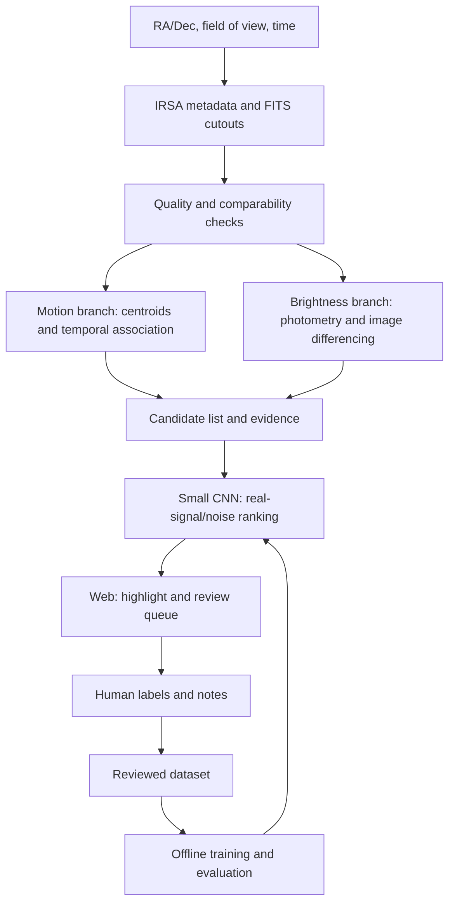

# SPHEREx Change Explorer — Technical Analysis and Implementation Direction

Research date: **30 October 2026**. This is a design document, not a report of a trained model or a pipeline that has run successfully on data.

Progress note: this is research from before implementation. The real-cutout demo and subsequent measurements are documented separately in [WISE0855_DEMO.md](WISE0855_DEMO.md); consult that document for the current product state.

## Proposed decision

Build a web experience that lets people view a sky region over time, see flagged areas of change, inspect evidence, and record an assessment. The design has three parts:

1. An astronomy pipeline prepares comparable observations and generates candidates.
2. A small CNN ranks candidates for real-signal/noise characteristics.
3. A review workspace shows images, measurements, quality warnings, and decision history.

Running the model directly in a browser is architecturally feasible. FITS processing and scientific validation remain on the backend. Running a model on the web does not by itself show that it is useful on SPHEREx data.

## 1. Challenge requirements and product scope

The [official challenge](https://www.spaceappschallenge.org/2026/challenges/planet-x-and-spherex/?tab=details) asks for a public web application where users enter RA/Dec and view an image sequence of the same sky region over time. Suggested test targets are Barnard's Star, Epsilon Indi B, WISE 0855, RW Aurigae, and R Draconis. AI is an extension proposed by the team.

The proposed product prioritizes three scenarios:

| Scenario | Evidence to show | Appropriate initial interpretation |
|---|---|---|
| Source changes position | Coordinates across epochs, errors, and fit relative to background stars | Moving-source candidate |
| Source changes brightness | Flux and errors in compatible passbands, light curve | Variable-source candidate |
| Source appears/disappears | New detection and detection limit in the other image | Transient candidate or missing-data case for review |

Do not conclude “Planet X” from a different-looking bright region. No catalog match means only that the current query did not find a match.

## 2. Available data and comparability checks

IRSA has released QR2 and began QR3 release in September 2026. The [IRSA announcement](https://irsa.ipac.caltech.edu/newsletter/2026/IRSA_NL_2026_08.html) says QR3 improves the PSF and related calibrations. The competition Resources tab not being available does not mean SPHEREx data is not public.

The [IRSA access documentation](https://caltech-ipac.github.io/spherex-archive-documentation/spherex-data-access/) describes SIA2, PyVO/Astroquery, and the cutout service. Proposed retrieval flow:

1. Query metadata by sky region, time, and collection.
2. Use `access_url` for a suitable observation, then request a cutout.
3. Preserve observation ID, release, and processing version in the manifest.
4. Download with caching, concurrency limits, and retry/resume behavior.

Do not hard-code a file list from a documentation example. Do not treat the same exposure processed in QR2 and QR3 as two independent epochs.

### Direct metadata check completed

On 30 October 2026, an SIA2 query was sent for RA `133.79512917°`, Dec `−7.24514722°`, radius `0.05°` (3 arcmin), derived from the WISE 0855 coordinates in the challenge. Two HTTP 200 responses used TABLEDATA with `QUERY_STATUS=OK`:

| Queried collection | Metadata records | Returned `t_min` range, MJD |
|---|---:|---|
| `spherex_qr2` | 278 | 60800.700028–61174.287218 |
| `spherex_qr3` | 0 | None in this query result |

The [query receipt](irsa-wise0855-metadata-check.json) was saved. These are records for a sky region, not independent epochs or WISE 0855 detections. FITS files were not downloaded, proper motion was not applied to the source position, and passband at the target pixel was not checked. A newer QR3 release does not imply suitable data exist for every region needed in the demo.

### Main risk: spectral color can be mistaken for temporal change

SPHEREx uses a **linear variable filter**: wavelength depends on detector position. The full spectrum is accumulated across multiple exposures; do not assume that each timestamp already contains 102 synchronized images. [SPHEREx team explanation](https://spherex.caltech.edu/page/survey).

Design implication: match images by wavelength/bandwidth at the candidate location, not only detector ID. If no compatible observation exists, the interface may still display the images, but the pipeline must reject a variability conclusion. Detector-level aggregation can be shown only as an exploratory product with its spectral assumptions stated.

## 3. Scientific conditions before running a CNN

| Issue | Proposed handling |
|---|---|
| Coordinate system, image rotation, WCS offset | Reproject onto a common viewing grid; measure and correct residual offsets using suitable background sources |
| Different PSFs | Use ePSF matched to position/version; match or forward-model each exposure |
| Changing background | Estimate local background and check zodiacal/straylight effects; retain processing details in provenance |
| Bad pixels, saturation, ghosts | Decode bitmasks by release; show their effect for each candidate |
| Calibration changes between releases | Prefer one consistent release; mix only after applying and checking official corrections |
| Missing coverage | Retain footprint/mask; do not turn missing pixels into zeros for the detector |
| Different observation depth | Compare at matched uncertainty; pair non-detections with detection limits |
| Small motion | Retain centroid/astrometry errors; do not present display resolution as evidence of greater measurement precision |

Points to retain from the documentation:

- MEF products contain science images, FLAGS, VARIANCE, ZODI, PSF, and wavelength information. WCS-WAVE is for visualization; scientific analysis should consult CWAVE/CBAND in spectral calibration products. [Data Products](https://caltech-ipac.github.io/spherex-archive-documentation/spherex-data-products/).
- PSF cutouts remain tied to the original detector and data version; do not replace every case with a generic Gaussian. [ePSF tutorial](https://caltech-ipac.github.io/irsa-tutorials/spherex-psf/).
- `reproject` assumes the input WCS is correct; it does not solve registration when WCS is wrong. [reproject documentation](https://reproject.readthedocs.io/en/stable/).
- Do not reject every `FLAGS != 0` pixel: SOURCE can be a normal real source and can be useful when estimating background. TRANSIENT in FLAGS may indicate a cosmic-ray hit, not an astronomical transient label. [Photometry and bit-flag documentation](https://irsa.ipac.caltech.edu/onlinehelp/spherex/spherex/sp.html).

Create PNGs only at the final display stage. Model inputs and measurements retain numerical values and units; do not train from screenshots with arbitrary contrast changes. Do not use generative enhancement to create details and then treat them as evidence.

## 4. Change-detection pipeline

### Motion branch

Measure source positions across observations, check displacement relative to the background, and link a tracklet when enough epochs exist. Use sky coordinates, actual times, and measurement errors. Avoid fitting global alignment anchored to the moving target itself.

Two epochs can form a displacement candidate but do not prove an orbit or reliably distinguish proper motion, parallax, and source-association error. The number of epochs, time baseline, and depth determine which conclusion is supportable.

### Brightness and transient branch

Measure flux in compatible passbands, build a reference from suitable epochs, then evaluate difference images and the light curve. Exclude the epoch under test from the reference; avoid long time coadds that can suppress or smear moving sources.

[ZOGY — Zackay, Ofek & Gal-Yam 2016](https://arxiv.org/html/1601.02655) provides a basis for image subtraction and detection statistics under assumptions about noise, registration, and sampling. It is a reference direction to evaluate, not a guarantee that all SPHEREx images meet its assumptions. The first version could use validated subtraction after matching, then compare it with ZOGY.

Resampling and convolution create correlated noise. Therefore, do not call a residual image divided by the square root of variance a “calibrated scientific sigma.” Check the empirical background distribution and injection–recovery before reporting statistical significance.

## 5. Suitable vision model

### First version: CNN score for real/noise candidates

[Braai in ZTF — Duev et al. 2019](https://arxiv.org/html/1907.11259) uses a science/reference/difference triplet to learn to distinguish real from bogus signals. The team can reuse the architecture idea; SPHEREx infrared images differ from ZTF, so ZTF results are not an SPHEREx benchmark.

Proposed inputs:

- Science patch at the epoch under review.
- Reference patch on the same grid and a compatible passband.
- Difference image retaining positive and negative signs.
- Validity mask and correctly handled uncertainty.
- Metadata: time difference, spectral/registration match quality, detector, and affected-pixel fraction.

Patch size and channel count are hyperparameters to test; `64×64` is a technical starting point, not an SPHEREx-optimized setting. Shared normalization must retain flux-change information; avoid normalizing each image independently in a way that removes the signal of interest.

The first output is a **ranking score**, with the option to abstain. Classifying “motion” versus “variability” also requires measurements over time. Call the score a probability only after checking calibration on a suitable dataset.

Do not use a fixed-position transient classifier as a gate that removes all moving-source candidates. A moving source creates a negative residual at the old position and a positive residual at the new one; this can resemble registration error. The motion branch needs its own positive examples and checks against the star background instead of labeling every dipole as bogus.

The [Braai repository](https://github.com/dmitryduev/braai) provides code and model references under an MIT license. Check the provenance/conditions of the data and weights separately, as well as ONNX conversion compatibility. Do not assume a pretrained SPHEREx model for this task is available.

### Later options

| Option | Proposed role | When to invest |
|---|---|---|
| CNN on triplets + metadata | Filter and rank bogus alerts | First version, after a baseline and labels exist |
| Siamese/temporal CNN | Learn relations among multiple epochs directly | Once a sufficiently diverse dataset and clear baseline exist |
| Self-supervised anomaly detection | Find cases outside familiar classes | Additional discovery branch; instrument noise must be checked |
| Few-shot vision-language model | Experiment with triplet classification and reviewer explanations | Can be tried early with few labels; evaluate on SPHEREx before using for filtering |

This is the team's design priority, not an empirical ranking. A VLM must not generate coordinates, flux, or detection claims. Measurement-derived explanation templates are a more verifiable starting point.

[Stoppa et al., Nature Astronomy 2025](https://www.nature.com/articles/s41550-025-02670-z) reports a mean accuracy of 93% using 15 sample triplets per survey across three optical datasets. This supports trying a VLM, but does not validate performance on SPHEREx. The study's prompt treats positive/negative residuals from misalignment as bogus; a moving-object search needs that criterion revised and tested.

A VLM can be compared with a baseline/CNN on the same held-out set. Do not copy the transient study's policy of preferring “less interesting” variables: variability is itself the target signal here. VLM self-rated coherence is only an experimental feature, not a substitute for calibration or independent review.

## 6. Web application and model placement

“Web-based” permits two deployment options: users access the model through an API, or download a small model to the browser. The proposal is to support backend inference first for standardized evaluation, then add in-browser inference after the model proves useful.

| Component | Proposed technology | Responsibility |
|---|---|---|
| Interface | Next.js/React + TypeScript | Queries, timeline, inspector, review queue |
| Sky map | Aladin Lite or custom cutout viewer | Coordinates, coverage, catalogs, overlays |
| API | Python/FastAPI | Create jobs and return metadata/results |
| Science worker | Astropy, PyVO/Astroquery, reproject, Photutils | FITS, WCS, PSF, photometry, detection |
| Training | PyTorch or a framework suited to reusable artifacts | Versioned datasets, models, and evaluation |
| Browser | ONNX Runtime Web in a Web Worker | Rank patches when device capabilities allow |
| Logical storage | Object store + result database | Separate images/tensors from metadata and review history |

No hosting service, database, object store, or GPU has been selected or provisioned. This is a component diagram, not infrastructure that already exists.

[ONNX Runtime Web](https://onnxruntime.ai/docs/tutorials/web/) supports WebGPU and WASM; execution providers support different operators. The [WebGPU guide](https://onnxruntime.ai/docs/tutorials/web/ep-webgpu.html) documents browser GPU usage. Feature detection, testing the actual model, and a WASM/API fallback are required; do not promise that every browser has a suitable GPU.

FITS/PSF processing and large batches belong in workers, not in each React render. The backend returns previews and numeric tensors for on-demand inference. Limit sky area, epochs, and resources per job; cache by manifest, pipeline version, and model version. The interface should show progress instead of holding one long HTTP request until processing finishes.

Results stored as official should include pipeline/model versions and be reproducible on the backend; client-side scores are interaction aids, not trusted results that automatically overwrite shared data.

## 7. User interaction

### Explore

Enter RA/Dec or choose a sample target; select time, field of view, and wavelength. Show a time × spectrum matrix immediately to indicate which images can be compared. Playback includes timestamps and actual time intervals; do not make irregular cadence look like real-time video.

### Inspect

The main image has a highlight linked to sky coordinates; clicking opens science/reference/difference together. A side panel shows the light curve with errors, coordinates across epochs, measurements, and quality flags. Color alone must not distinguish candidate classes.

Prefer overlays of residual regions or measured tracks. A model saliency map, if available, is an additional diagnostic; do not call it a confirmed change region.

### Review

The reviewer selects “real-signal candidate,” “noise/processing artifact,” or “insufficient evidence,” with change type and a note. Retain the initial model output, reviewer, time, and evidence inspected. Do not label a decision “planet discovered.”

Reserve some of the queue for high scores and some for uncertain/out-of-domain cases and random samples. This helps surface errors the model is missing. Send label conflicts to another reviewer; do not retrain automatically after every click.

## 8. Training and evaluation

The five challenge targets are science smoke tests, not enough for a general training/evaluation dataset.

Proposed dataset combination:

1. Real SPHEREx candidates reviewed by domain specialists.
2. Hard negatives: ghosts, saturation, WCS/PSF offsets, image edges, blended sources, and cross-wavelength images.
3. Synthetic sources injected into original digital images using suitable PSFs: controlled flux or position changes. Rerun the full pipeline to measure recovery; document noise/SED assumptions and simulation limits.

Split train/validation/test by **source, sky region, and time** before creating augmented pairs/patches. Do not put crops from the same source or differently processed versions of the same exposure into the test set. For temporal evaluation, do not include future data in the reference beyond the defined scope.

| Metric | What it tells you |
|---|---|
| Recall by flux, apparent speed, and observing conditions | Which signals the model misses |
| Precision and false positives per sky region/epoch | How much noise reviewers must reject |
| Injection recovery rate | Where the full pipeline can see a signal |
| Position and flux errors | How far the result can be used for measurement |
| Useful candidates per review pass/minute | Whether AI reduces human workload |
| Abstention rate and score calibration | Whether the model recognizes its limits |
| Load time, inference, and memory on real devices | Whether browser deployment is practical |

Compare three configurations on the same held-out set: scientific baseline; baseline + CNN; and baseline + CNN + queue policy. Keep the CNN only if it improves review quality/workload at acceptable recall. Set concrete thresholds after a pilot; there is no basis to promise “99% accuracy.”

## 9. Implementation sequence

### Gate 0 — verify the data

Create a table for all five targets with coverage, epochs, passband, release, quality, and expected signal. Download a few cutouts and inspect real content. Gate condition: at least one comparable sequence exists and remaining limitations are documented.

### Gate 1 — one complete web workflow

Choose a region with suitable real data; build query → processing → playback → candidate → review. Cache verified frames for a stable demo while recording source and timestamp. If a new query has no comparable data, return an honest status.

### Gate 2 — useful AI

Add the CNN once labels and independent evaluation exist. A demo model can be tested on injected sources, but must be labeled as a simulation; do not report it as real-object detection performance.

### Assumed 48-hour scope

This is an estimate for a 48-hour hackathon, not a verified event schedule:

| Time range | Priority output |
|---|---|
| 0–8 hours | Check data and manifest; find one valid image sequence |
| 8–20 hours | Baseline viewer with playback and error states |
| 20–32 hours | Highlights, inspector, review, provenance storage |
| 32–42 hours | Experimental CNN if labels suffice; independent check and browser export if feasible |
| 42–48 hours | Test targets, document limits, demo, and presentation |

Training a reliable general model and validating enough conditions is later research. Do not make training a large model from scratch a requirement for a usable application.

## 10. What this research has not established

- Metadata for the WISE 0855 region was successfully checked over HTTPS/SIA2 as recorded in section 2; all five targets were not checked, and FITS images were not downloaded/measured. Metadata evidence does not replace inspection of image data.
- The number of image pairs with passband and quality suitable for each target has not been confirmed.
- No model has been trained, converted to ONNX, or benchmarked on SPHEREx.
- No deployment service has been selected, and cost has not been estimated from real workloads.
- The current Explanatory Supplement PDF is too large for the web tool to read directly; conclusions here rely on official HTML guides, tutorials, and papers accessed. Read the supplement when implementing detailed calibration/bitmask handling.
